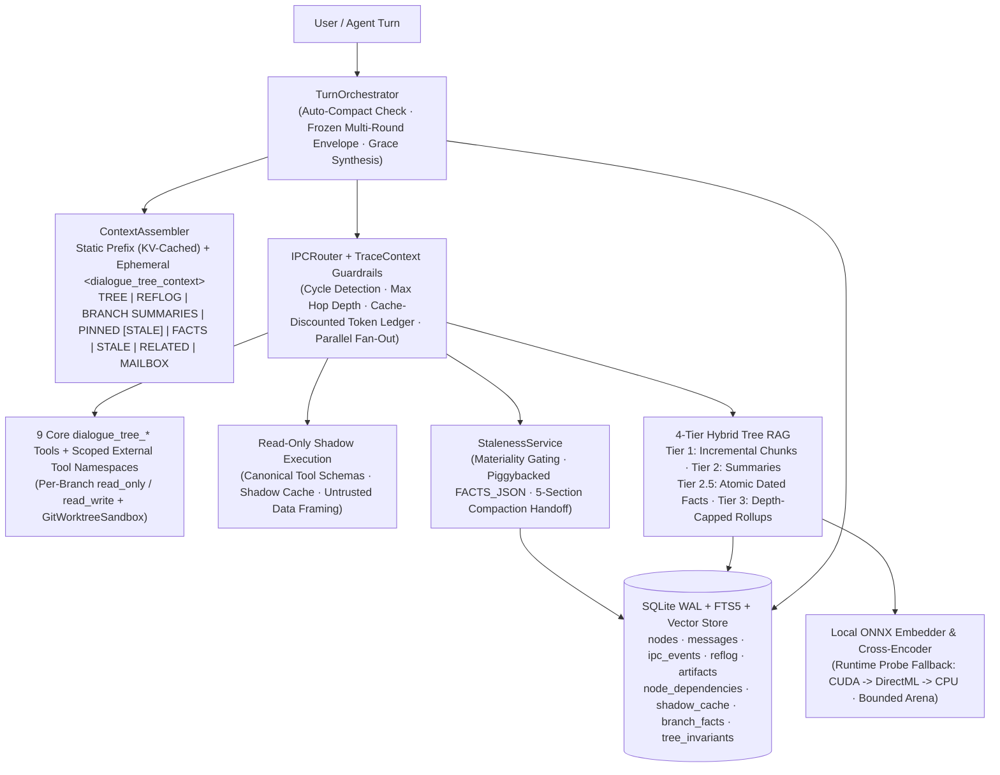

# Chatree

**Hierarchical Actor-Model Dialogue Trees for Bounded-Context, Verifiable, Non-Destructive LLM Conversations**

[](https://github.com/shervinemp/Chatree/actions/workflows/ci.yml)
[](LICENSE)
[](https://www.python.org/downloads/)
[](#artifact-evaluation--reproducibility)
[](paper/chatree_paper.md)
[](#architecture)
[](#cli-mcp-server--optional-demo-ui)

**Chatree** is a local-first Python framework and research testbed that replaces flat linear chat transcripts with **hierarchical actor-model dialogue trees**. Every topic tangent, speculative prototype, or compacted continuation runs as an isolated tree node with copy-on-write prefix inheritance, read-only shadow inspection, causal staleness coherence, dead-end quarantine, non-destructive compaction, and a 4-tier hybrid tree index—keeping active working context $O(1)$-bounded while retaining verbatim ancestor provenance.

---

## Table of Contents

1. [Motivation & Design Principles](#motivation--design-principles)
2. [Architecture](#architecture)
3. [Core Primitives (`dialogue_tree_*`)](#core-primitives-dialogue_tree_)
4. [Systems Capability Comparison](#systems-capability-comparison)
5. [Empirical Evaluation](#empirical-evaluation)
6. [Limitations & Threats to Validity](#limitations--threats-to-validity)
7. [Installation & Python SDK Quickstart](#installation--python-sdk-quickstart)
8. [Artifact Evaluation & Reproducibility](#artifact-evaluation--reproducibility)
9. [CLI, MCP Server & Optional Demo UI](#cli-mcp-server--optional-demo-ui)
10. [Repository Structure](#repository-structure)
11. [Citation](#citation)

---

## Motivation & Design Principles

Long-horizon conversational agents face four coupled failure modes in flat threads:
1. **Context growth & dead-end pollution:** Abandoned explorations remain permanently interleaved with settled decisions.
2. **Lossy compression:** Destructive rolling summarization (e.g., in-place `/compact`) discards fine-grained verbatim details once compacted.
3. **Silent causal drift:** Revising an earlier decision does not notify downstream workstreams that previously depended on it.
4. **KV-cache thrashing:** Mutating system prompts or interleaved histories invalidates provider prefix caches at byte 0.

Chatree addresses these through six orthogonal invariants:
- **Immutable Static Prefix + Ephemeral Tail Envelope:** Static branch history (`build_static_prefix`) is never mutated; dynamic topology (`TREE`), temporal history (`REFLOG`), `BRANCH SUMMARIES`, `PINNED` invariants, Tier-2.5 `FACTS`, `STALE` alerts, `RELATED` pointers, and `MAILBOX` handoffs are injected solely into the ephemeral `<dialogue_tree_context>` tail on the newest user turn, preserving byte-0 prefix caching (including Anthropic's 4-breakpoint fork-boundary caching and canonical tool-schema preservation on shadow turns).
- **Read-Only Shadow Turns & Semantic Memoization:** Cross-branch reads (`dialogue_tree_query_branch`) return cached Tier-2 summaries at 0 LLM tokens when clean, or execute an isolated read-only shadow turn against the target's verbatim turns without polluting either branch's history. Repeat queries hit `shadow_cache` via exact hash or identifier-guarded semantic cosine match ($\ge 0.90$).
- **Materiality-Gated Transitive Staleness & `PINNED` Coherence:** Reopening and modifying a branch classifies edits as *cosmetic* (minor `v1.1`, zero cascade) vs. *material* (major `v2.0` + identifier/polarity delta), propagating multi-hop staleness alerts (`A -> B -> C`) and flagging affected tree-wide `PINNED` invariants as `[STALE]`.
- **Dead-End Quarantine (`ARCHIVED`):** Scrapped branches archived via `dialogue_tree_archive_branch` remain auditable in SQLite but are excluded by default from all four RAG tiers (`chunk`, `summary`, `fact`, `rollup`), `BRANCH SUMMARIES`, and active atomic fact queries.
- **4-Tier Hybrid Tree Index with Piggybacked Temporal Facts:** Combines Tier-1 contextual turn chunks (`[Path | Goal]`, incremental $O(1)$ tail indexing), Tier-2 lazy summaries, Tier-2.5 piggybacked branch-scoped atomic dated facts (`FACTS_JSON:` with absolute calendar date resolution, zero extra LLM calls), and Tier-3 depth-capped subtree rollups (`max_rollup_depth=8`) via SQLite FTS5 BM25 + vectorized NumPy cosine RRF + local ONNX cross-encoder reranking (with runtime GPU smoke-test fallback `CUDA -> DirectML -> CPU`).
- **Non-Destructive Auto-Compaction (`B1 -> B2 -> ... -> Bk`):** When a branch crosses its token threshold, Chatree commits a structured 5-section anchor-preserving handoff on the warm KV prefix and spawns a linked continuation branch (with an automatic savings guard preventing expansion), leaving every ancestor verbatim and shadow-queryable indefinitely.

---

## Architecture



---

## Core Primitives (`dialogue_tree_*`)

All built-in primitives are namespaced under `dialogue_tree_*` to guarantee zero collision with external/MCP tool packs (`ct.tool_namespace("...")`):

| Tool | Purpose | Allowed in Shadow? | State Effect |
|---|---|:---:|---|
| `dialogue_tree_create_branch` | Spawn child branch (`fork`, `slice`, or `clean`) with optional `autonomous=True` sub-turn | No | Creates node, optionally switches `HEAD` |
| `dialogue_tree_send_to_branch` | Deliver message/versioned artifacts (`slug@vN`) to mailbox; `finish=True` squash-merges to parent | No | Writes mailbox / completes child |
| `dialogue_tree_query_branch` | Known-ID inspection: omit `prompt` for 0-token cached summary; pass `prompt` for read-only shadow Q&A | Yes | Read-only (records dependency edge) |
| `dialogue_tree_search_branches` | 4-tier hybrid BM25 + vector RRF search across `all`, `ancestors`, `subtree`, or `siblings` | Yes | Read-only |
| `dialogue_tree_search_and_query` | Single-hop compound search + parallel read-only shadow fan-out for unknown branch IDs | No | Read-only |
| `dialogue_tree_switch_branch` | Git-style `HEAD@{k}` / `back` / `forward` navigation with destination preview & 1-turn `follow_up_prompt` | No | Updates `HEAD` & reflog |
| `dialogue_tree_compact_branch` | Non-destructive 5-section anchor compaction into linked continuation child (source kept verbatim) | No | Spawns continuation, completes source |
| `dialogue_tree_pin_invariant` | Pin/update/unpin up to 8 tree-wide invariants (`read_write` only; auto-flagged `[STALE]` on source edit) | No | Updates `tree_invariants` |
| `dialogue_tree_archive_branch` | Quarantine dead-end non-root branch (`status=ARCHIVED`) from all 4 RAG tiers and return `HEAD` to parent | No | Archives branch, updates rollups |

---

## Systems Capability Comparison

| Capability | Full-Context Linear | Sliding Window | Flat Hybrid RAG | Mem0 | Letta / MemGPT | Zep / Graphiti | Context-Folding | MIT RLM | **Chatree** |
|---|:---:|:---:|:---:|:---:|:---:|:---:|:---:|:---:|:---:|
| Bounded $O(1)$ working context | ✗ | ✓ | ✓ | ✓ | ✓ | ✓ | ✓ | Partial | **✓** |
| Lossless verbatim ancestor recall | ✓ (until limit) | ✗ | Partial (chunks) | ✗ (distilled) | Partial (archival) | Partial | ✗ (folded) | ✓ (REPL) | **✓ (Shadow)** |
| Explicit branching & dead-end quarantine | ✗ | ✗ | ✗ | ✗ | ✗ | ✗ | Partial | ✗ | **✓ (`ARCHIVED`)** |
| Materiality-gated causal staleness | ✗ | ✗ | ✗ | ✗ | ✗ | Temporal edges | ✗ | ✗ | **✓ (Transitive)** |
| Non-destructive compaction chain | ✗ | ✗ | ✗ | ✗ | Destructive | ✗ | Destructive | N/A | **✓** |
| Piggybacked atomic temporal facts | ✗ | ✗ | ✗ | ✓ (separate LLM) | ✗ | ✓ (KG) | ✗ | ✗ | **✓ (0 extra calls)** |
| Provider KV-cache prefix preservation | ✓ (~95%) | ✗ (~7%) | ✗ (~0–2%) | ✗ (~0%) | Partial | ✗ | Partial | ✗ (0%) | **✓ (~50–76%)** |
| Git-style `HEAD@{k}` reflog navigation | ✗ | ✗ | ✗ | ✗ | ✗ | ✗ | ✗ | ✗ | **✓** |

---

## Empirical Evaluation

All live benchmarks below were executed with `deepseek/deepseek-chat` and zero-API-cost local ONNX retrieval (`BAAI/bge-small-en-v1.5` 384-dim embeddings + `Xenova/ms-marco-MiniLM-L-6-v2` cross-encoder) against **unmodified upstream packages** (`mem0ai==2.2.1`, MIT `rlms==0.1.3`) on official benchmark datasets (`locomo10.json`, `longmemeval_s_cleaned.json`) with `use_provided_summaries=False`. Raw logs, manifests, CSVs, and LaTeX tables are stored in [`results/deepseek_eval/`](results/deepseek_eval/).

### 1. Official LoCoMo (ACL 2024 — Stratified 10 Conversations, 245 Balanced QAs)

Stratified macro-balanced selection (`5 QAs/category/conv` across all 10 conversations; 272 sessions total; exact paired evaluation under the fixed distractor-separated adversarial rubric, [`exp3_locomo_rejudged_v3.md`](results/deepseek_eval/exp3_locomo_rejudged_v3.md)):

| System | `n` | Accuracy (95% Bootstrap CI) | Single-Hop | Multi-Hop | Temporal | Open-Domain | Adversarial | Peak Tok | KV Cache | McNemar `p` vs. v3 |
|---|---:|---:|---:|---:|---:|---:|---:|---:|---:|---:|
| **`chatree_two_tier_v3` (+Tier-2.5 Facts)** | **245** | **77.1%** `[71.8, 82.5]` | 86.0% | 80.0% | **74.0%** | **57.8%** | 86.0% | **6,390** | **60.0%** | ref |
| `full_context_linear` | 245 | 76.3% `[71.4, 82.0]` | **88.0%** | **82.0%** | 68.0% | 55.6% | 86.0% | 35,097 | 95.4% | 0.8744 |
| `mem0_official` (`mem0ai==2.2.1`) | 245 | 73.5% `[68.2, 79.2]` | 78.0% | 66.0% | **74.0%** | 53.3% | 94.0% | 874 | 0.1% | 0.2225 |
| `rlm_official` (`rlms==0.1.3`)‡ | 117 | 70.9% `[62.4, 78.6]` | 76.0% | 64.0% | **80.0%** | 55.0% | 77.3% | 28,166 | 0.0% | 0.4725 |
| `chatree_two_tier` (v2, pre-Tier-2.5) | 245 | 64.5% `[58.8, 70.6]` | 78.0% | 50.0% | 52.0% | 44.4% | **96.0%** | **4,250** | **75.5%** | **0.0001\*** |
| `flat_hybrid_rag` | 245 | 48.2% `[42.0, 54.3]` | 46.0% | 26.0% | 40.0% | 33.3% | 94.0% | 725 | 2.3% | **<0.0001\*** |
| `tree_summary_only` (Context-Folding) | 245 | 41.2% `[35.5, 47.3]` | 40.0% | 32.0% | 16.0% | 31.1% | 86.0% | 1,480 | 11.9% | **<0.0001\*** |

> **Methodological Notes:**
> - **#1 Overall at 5.5× Smaller Peak Context (`n=245`):** `chatree_two_tier_v3` (**77.1%**) surpasses `full_context_linear` (`76.3%`, 35,097 vs. 6,390 peak tokens), `mem0_official` (`73.5%`, including **+14.0 pts on `multi_hop`** and **+8.0 pts on `single_hop`**, with **60.0% vs. 0.1%** KV cache hit), `rlm_official` (`70.9%`, 4.4× smaller peak context), `flat_hybrid_rag` (`48.2%`, **+28.9 pts**, $p < 10^{-4}$), and `tree_summary_only` (`41.2%`, **+35.9 pts**, $p < 10^{-4}$).
> - **Tier-2.5 Piggybacked Atomic Facts Ablation (`v3` vs. `v2`, `n=245` paired):** Adding zero-extra-call piggybacked dated atomic facts delivered a highly significant **+12.6 pt overall lift** (`64.5% -> 77.1%`, McNemar $p = 0.0001^*$), driving **+30.0 pts on `multi_hop`** (`50.0% -> 80.0%`), **+22.0 pts on `temporal`** (`52.0% -> 74.0%`), **+13.4 pts on `open_domain`** (`44.4% -> 57.8%`), and **+8.0 pts on `single_hop`** (`78.0% -> 86.0%`).
> - **Fixed Adversarial Rubric:** All 7 systems above were re-scored under the fixed rubric in [`external_benchmarks.py`](src/chatree/eval/external_benchmarks.py) (separating `distractor_answer` from `ground_truth` and crediting truthful false-premise corrections). ‡`rlm_official` (`n=117`) reflects its partial checkpoint; its McNemar $p$-value (`0.4725`) is computed strictly over the exact 117-QA paired intersection with `chatree_two_tier_v3`.

### 2. Official LongMemEval-S (ICLR 2025 — 30 Stratified Items, ~48 Sessions / ~115k Tokens Each)

Stratified across all 6 official categories (5 items/category, 1,429 sessions ingested total, [`exp4_longmemeval_v3.md`](results/deepseek_eval/exp4_longmemeval_v3.md)):

| System | Accuracy (95% CI) | Single-User | Single-Asst | Pref | Knowledge-Update | Temporal | Multi-Session | Peak Tok | Query USD (+Ingest) | KV Cache | p50 / p95 ms | McNemar `p` vs. v3 |
|---|---:|---:|---:|---:|---:|---:|---:|---:|---:|---:|---:|---:|
| **`chatree_two_tier_v3` (+Tier-2.5)** | **80.0%** `[66.7, 93.3]` | 80.0% | **100.0%** | **100.0%** | 80.0% | 60.0% | **60.0%** | **6,295** | **\$0.235** (+\$0.884) | **31.4%** | 5.08s / **7.92s** | ref |
| `full_context_linear` | 70.0% `[53.3, 86.7]` | **100.0%** | **100.0%** | 20.0% | **100.0%** | 60.0% | 40.0% | 108,772 | \$0.882 (+\$0.000) | 0.0% | **2.40s / 5.03s** | 0.5078 |
| `rlm_official` | 70.0% `[53.3, 86.7]` | 80.0% | **100.0%** | 40.0% | 80.0% | **80.0%** | 40.0% | 21,373 | \$0.375 (+\$0.000) | 0.0% | 11.23s / 32.58s | 0.5810 |
| `chatree_two_tier` (v2) | 63.3% `[46.7, 80.0]` | 80.0% | 60.0% | 60.0% | 80.0% | 60.0% | 40.0% | 6,927 | \$0.162 (+\$0.629) | **49.6%** | 5.98s / 8.18s | 0.1797 |
| `flat_hybrid_rag` | 40.0% `[23.3, 56.7]` | 80.0% | 20.0% | 0.0% | 80.0% | 20.0% | 40.0% | 717 | \$0.004 (+\$0.000) | 39.3% | 3.47s / 7.74s | **0.0018\*** |

> **Key Takeaways:** `chatree_two_tier_v3` ranks **#1 overall at 80.0%** (+16.7 pts over v2, +10.0 pts over both `full_context_linear` and `rlm_official`, and +40.0 pts over `flat_hybrid_rag`, $p = 0.0018^*$), leading all systems on `single-session-preference` (**100.0%** vs. 20–40%) and `multi-session` (**60.0%** vs. 40%). It stays at **17.3× smaller peak context** than `full_context_linear` (`6,295` vs. `108,772`), **3.8× lower query USD** (`\$0.235` vs. `\$0.882`), **4.1× faster p95 latency** than `rlm_official` (`7.92s` vs. `32.58s`), and **31.4% KV-cache hit** vs. **0.0%** for linear and RLM. On LongMemEval's single-question-per-history layout, cold ingest (`\$0.884` across 1,429 sessions) is paid once for 1 QA rather than amortized across a multi-turn workspace.

### 3. Controlled Stress Suites, Ablations & Crossover Scaling (Tracks 1 & 2)

- **Track 1 — 5-Family Stress Suite ([`exp1_suite.md`](results/deepseek_eval/exp1_suite.md)):** `tree_ipc_full` achieved **8/8 (100.0%) strict pass** with **0% leakage** and **0% stale contradiction errors** across all 5 families (including `multihop-revision-staleness`, where `flat_rag`, `tree_summary_only`, and `tree_ipc_no_staleness` all failed with 100% stale contradictions).
- **Track 2 — 10-Row Ablations & $K$-Scaling Crossover ([`exp2_ablations.md`](results/deepseek_eval/exp2_ablations.md), [`exp2_crossover.md`](results/deepseek_eval/exp2_crossover.md)):** Removing read-only shadow inspection (`no_shadow_turns_folding`) collapsed strict pass rate to **0.0%** (McNemar $p = 0.0312^*$), while disabling staleness/transitivity introduced `14.3%` stale errors. Across $K \in \{2, 4, 8\}$ distractors, `tree_ipc_full` held **100.0% strict pass** and crossed below `linear` on cumulative total tokens at $K=8$ (**29,589 vs. 39,680 tokens**; peak `957` vs. `4,266` tokens; p50 latency `1.19s` vs. `1.42s`).

### 4. Live Multi-Turn Jump-Around & Infinite-Context Compaction (Tracks 5 & 6)

#### Track 6 — Live Multi-Generation Infinite-Context Compaction ([`exp6_compaction_bench.md`](results/deepseek_eval/exp6_compaction_bench.md))

| System | Generations | Compacts | Anchored Recall | Non-Anchored Verbatim Recall | Overall | Peak Tok | Final Tok | Est. USD | Gen-1 Preserved |
|---|---:|---:|---:|---:|---:|---:|---:|---:|---:|
| **`chatree_non_destructive`** | **10** | **9** | **100.0%** | **100.0%** | **100.0%** | **1,727** | **1,723** | \$0.013 | **4 / 4** |
| `destructive_rolling` | 7 | 6 | 100.0% | **0.0%** | 50.0% | 1,483 | 1,985 | \$0.006 | 0 / 4 |
| `sliding_window` | 1 | 0 | 0.0% | **0.0%** | 0.0% | 1,144 | 1,108 | \$0.004 | 0 / 4 |

> Across 9 successive compactions, destructive rolling summarization kept anchored decisions (`100%`) yet **irrecoverably destroyed every non-anchored Turn-1 verbatim detail (`0.0%`)**, whereas Chatree's non-destructive continuation chain held active context flat at **1,723 tokens** while retrieving Gen-1 verbatim facts at **100.0%** via ancestor shadow inspection.

#### Track 5 — Live 18-Turn Jump-Around Chatbot (Default & System-Agnostic Natural Prompts)
- **System-Agnostic Natural Prompts ([`exp5_natural_jump_around.csv`](results/deepseek_eval/exp5_natural_jump_around.csv)):** With zero Chatree/tool jargon in user turns, `chatree_live` achieved **100.0% recall**, **1.00 LLM-judge score** (tying `linear`), **0.0% dead-end leakage**, **82.7% KV-cache hit**, **77.8% autonomous navigation accuracy** (4 branches, 5 jumps, 11 shadow queries), and lower peak context (`7,291` vs. `8,525`), while `sliding_window` dropped to `94.4%` recall (`0.92` judge, `9.1%` cache) and `flat_rag` failed completely (`0.0%`).
- **Default Prompt Track ([`exp5_jump_around.csv`](results/deepseek_eval/exp5_jump_around.csv)):** `chatree_live` achieved **100.0% recall**, **100.0% navigation accuracy**, **0.0% dead-end leakage** (vs. `33.3%` for `linear` and `rlm_official`), **0.967 judge score**, and **73.5% KV-cache hit**. Over this short 18-turn horizon (~8k linear tokens), `chatree_live` still pays an orchestration overhead (`360k` vs. `76.5k` total input tokens on the natural track; `\$0.034` vs. `\$0.006`), confirming that dialogue trees shine primarily at long horizons, high branching factor, or context overflow rather than short linear threads.

---

## Limitations & Threats to Validity

In accordance with academic artifact-evaluation standards, we explicitly document known limitations and active research gaps:

1. **Interactive orchestrator vs. structured `TreeQueryEngine`:** External benchmarks (`ChatreeSystemAdapter`) and `tree.ask(..., deep=True)` now share the unified [`TreeQueryEngine`](src/chatree/engine/query.py) pipeline, whereas interactive turns in `TurnOrchestrator` choose tools autonomously. Tier-2.5 ephemeral `FACTS` hints are wired into `TurnOrchestrator`, but end-to-end unscripted live-agent LoCoMo/LongMemEval evaluation remains future work.
2. **Single-model & self-judging bias:** Live evaluations thus far used `deepseek/deepseek-chat` for both generation and LLM judging on a single seed. The runner supports `--judge-model <cross-family-model>` (e.g., Claude / GPT-4o) and `--rejudge-locomo-ckpt` for cross-family judge audits and Cohen's $\kappa$ validation.
3. **Context-overflow regime (`LongMemEval-M`, >1M tokens):** Live LongMemEval runs above used `LongMemEval-S` (~115k tokens, inside DeepSeek's 128k window). `LongMemEval-M` support (`--lme-split m`, 2.6 GB dataset, ~500 sessions / ~1.5M tokens per query) is implemented for >1M-token overflow testing.
4. **Hosted-API KV-cache TTL:** On hosted providers (Anthropic, DeepSeek, OpenAI), server-side KV caches expire after ~5–10 minutes; non-destructive compaction preserves *verbatim message prefixes* indefinitely (enabling warm cache hits within TTL and instant reload on self-hosted RadixAttention / LMCache engines), not permanent hosted VRAM residency.
5. **Single-process SQLite storage & $O(N)$ vector scan:** `SQLiteRepository` uses WAL + in-process `asyncio.Lock` and serves per-tree vector queries via `sqlite-vec` or a strongly consistent pre-normalized NumPy matrix cache (`unit_mat @ q`, <1 ms at 5k chunks). Multi-tenant / 100k+ chunk deployments will require an ANN index (HNSW) or a Postgres/`pgvector` `StorageBackend` implementation.
6. **Sandbox scope:** `GitWorktreeSandbox` isolates git working trees per branch without OS/container/network sandboxing; exact BPE token counting requires installing optional `tiktoken` (otherwise the calibrated zero-dependency `HeuristicTokenCounter` is used).

---

## Installation & Python SDK Quickstart

Requires **Python 3.12+** and [`uv`](https://docs.astral.sh/uv/) (or `pip`). Chatree is **100% provider-agnostic** across both LLM inference and embeddings:

- **Zero-LiteLLM `OpenAICompatibleProvider` & `OpenAICompatibleEmbedder`** (built-in, zero extra packages): speaks standard HTTP + SSE `/v1/chat/completions` and `/v1/embeddings` directly with **OpenAI, Ollama, vLLM, SGLang, LM Studio, llama.cpp, OpenRouter, DeepSeek, Groq, Together, Fireworks, Mistral, xAI, Cerebras, SambaNova, HuggingFace Router, and custom proxies**.
- **`LiteLLMProvider`** (`chatree[litellm]`): routes across 100+ providers with native Anthropic 4-breakpoint prompt caching (`cache_control`), AWS Bedrock, Vertex AI, Azure OpenAI, Gemini, and Cohere.
- **`CallableLLMProvider` & `LLMProvider` Protocol**: wrap any custom Python function or native vendor SDK (Anthropic SDK, Google GenAI SDK, HuggingFace Transformers, LangChain, etc.) in 3 lines.
- **Automatic Driver Selection (`llm_provider="auto"`):** uses `LiteLLMProvider` when `litellm` is installed and transparently falls back to `OpenAICompatibleProvider` when it is not.

```bash
# Core framework (SQLite WAL + FTS5 + zero-dep OpenAI-compatible HTTP/SSE + SDK + CLI + MCP)
uv sync

# Full install with LiteLLM multi-provider routing, local ONNX RAG, sqlite-vec, and FastAPI server
uv sync --all-extras --extra local-rag
```

Optional extras in [`pyproject.toml`](pyproject.toml):
- `chatree[litellm]` — DeepSeek, Anthropic, OpenAI, Gemini, OpenRouter, Ollama, vLLM/SGLang
- `chatree[local-rag]` — Local ONNX embeddings (`BAAI/bge-small-en-v1.5`) & cross-encoder reranking (`fastembed`), with automatic `CUDA -> DirectML -> CPU` runtime fallback
- `chatree[vec]` — Native `sqlite-vec` C extension
- `chatree[server]` — Optional FastAPI REST + SSE server

```python
import asyncio
from chatree import ArtifactInput, Chatree, ChatreeConfig, GuardrailPolicy

async def main() -> None:
    cfg = ChatreeConfig(
        db_path="./data/chatree.db",
        default_model="mock/chatree-demo",  # swap for "deepseek/deepseek-chat", "anthropic/claude-sonnet-4-5", etc.
        guardrails=GuardrailPolicy(auto_compact_enabled=True, auto_compact_threshold_tokens=24_000),
    )
    async with Chatree.open(cfg.db_path, config=cfg) as ct:
        tree = await ct.create_tree("Nebula API Gateway")
        root = await tree.root()

        await root.chat("Hard SLO is P99_LATENCY_120MS on Rust/Axum.")
        await tree.pin("slo", "P99_LATENCY_120MS", source_node_id=root.id)

        # Spawn isolated branch & commit versioned artifact
        auth = await root.spawn("Design JWT signing and TTL", title="Auth Design", mode="clean")
        await auth.chat("Settled on ED25519_SIGNING and JWT_TTL_5M_ROTATING.")
        await auth.finish(
            summary="ED25519_SIGNING + JWT_TTL_5M_ROTATING.",
            artifacts=[ArtifactInput(slug="auth.md", title="Auth Spec", content="# Auth\nED25519_SIGNING")],
            auto_commit=True,
        )

        # Quarantine a scrapped speculative prototype from all 4 RAG tiers
        dead = await root.spawn("Test GraphQL federation", title="GraphQL Prototype", mode="clean")
        await dead.chat("GRAPHQL_FEDERATION_V0 adds 24 hops.")
        await dead.archive(reason="Violates P99_LATENCY_120MS SLO")

        # Read-only shadow turn against Auth Design (0 mutation, memoized in shadow_cache)
        shadow = await root.request(auth.id, prompt="What exact JWT TTL is active?")
        print(shadow["answer"])

        # Non-destructive compaction preserving root verbatim for future shadow queries
        cont, meta = await root.compact(keep_recent_turns=2, reason="Checkpoint Phase 1")
        print(f"Compacted {meta['tokens_before']} -> {meta['tokens_after']} tokens into {cont.id}")

asyncio.run(main())
```

Runnable examples: [`examples/01_quickstart_sdk.py`](examples/01_quickstart_sdk.py) through [`examples/05_publishable_eval_and_sota.py`](examples/05_publishable_eval_and_sota.py).

---

## Artifact Evaluation & Reproducibility

### Step 1: Zero-Key Functional Verification (~45s)
Runs all **83 unit and integration tests** covering IPC guardrails, copy-on-write forks, shadow memoization, materiality-gated transitive staleness, `dialogue_tree_archive_branch` dead-end quarantine, `chat` vs. promotable `subagent` node kinds, strict `HEAD`-only `reflog` + MRU envelope + supervisor worker cancellation cascade, GPU runtime fallback, provider-agnostic HTTP/SSE & callable adapters, unified `TreeQueryEngine`, cached NumPy vector index, pluggable `TokenCounter`, Tier-2.5 atomic facts, `PINNED` staleness, portable v3 `.dialogue/` round-trips, CLI/MCP/REST API parity, non-destructive compaction savings guards, negation-aware scoring, LoCoMo/LongMemEval loaders, and Track 6 compaction benchmarks:

```bash
uv run pytest -v
```

### Step 2: Offline Mock Benchmark Reproduction (Zero Cost)
```bash
uv run chatree eval --suite all --csv-out ./out/suite.csv --grpo-out ./out/grpo.jsonl
uv run chatree eval --ablation-matrix --latex-out ./out/ablations.tex
uv run chatree eval --crossover-ks 2,4,8 --latex-out ./out/crossover.tex
uv run chatree eval --jump-around --csv-out ./out/jump.csv --jsonl-out ./out/jump.json
```

### Step 3: Live External & Overflow Benchmarks (Any LLM Provider)
Copy [`.env.example`](.env.example) to `.env` and set the API key for whichever provider you choose (or point `--api-base` at local Ollama/vLLM/SGLang with zero API key). Datasets auto-download into `data/benchmarks/` (gitignored):

```bash
# Run Tracks 3, 4, 5, 6 against ANY provider (--model openai/gpt-4o, anthropic/claude-sonnet-4-5,
# gemini/gemini-2.5-pro, deepseek/deepseek-chat, ollama/llama3.2, vllm/Qwen/Qwen2.5-72B, etc.)
uv run python scripts/run_publishable_eval.py \
  --model anthropic/claude-sonnet-4-5 \
  --judge-model openai/gpt-4o \
  --tracks 3,4,6 --paper-baselines \
  --locomo-convs 10 --locomo-per-cat 5 \
  --lme-split m --lme-per-cat 10 \
  --concurrency 4

# Re-judge saved LoCoMo checkpoints with the fixed adversarial rubric or a cross-family judge
uv run python scripts/run_publishable_eval.py \
  --model deepseek/deepseek-chat \
  --judge-model openai/gpt-4o \
  --locomo-convs 10 --locomo-per-cat 5 \
  --rejudge-locomo-ckpt results/deepseek_eval/exp3_locomo.ckpt.jsonl \
  --out-dir results/deepseek_eval
```

Every external run emits crash-safe `*.ckpt.jsonl` checkpoints, paired `McNemar` and bootstrap CI tables (`*.md`, `*.csv`, `*.tex`), and exact provenance manifests (`*_manifest.json` recording model IDs, embedder/reranker versions, git SHA, token totals, and USD costs).

---

## CLI, MCP Server & Optional Demo UI

```bash
# CLI tree operations & portable human-greppable .dialogue/ backup
uv run chatree init "Distributed Caching"
uv run chatree trees
uv run chatree ask <tree_id> "What TTL did we select?" --deep
uv run chatree pin <tree_id> cache_engine "Valkey 8.0"
uv run chatree facts <tree_id>
uv run chatree compact <tree_id> --keep-turns 4
uv run chatree archive <tree_id> --node <dead_end_id> --reason "superseded"
uv run chatree dump <tree_id> ./.dialogue/cache-tree
uv run chatree load ./.dialogue/cache-tree
uv run chatree export <tree_id> --out ADR.md

# Expose local Chatree store to external coding agents via MCP (stdio JSON-RPC 2.0)
uv run chatree mcp

# Optional FastAPI + React reference UI
uv run chatree serve --port 8001
cd demo/ui && pnpm install && pnpm dev
```

---

## Repository Structure

```text
Chatree/
├── src/chatree/
│   ├── config.py                  # ChatreeConfig, GuardrailPolicy, RagConfig, AblationConfig
│   ├── protocols.py               # Runtime-checkable LLMProvider, Embedder, Reranker, TokenCounter, StorageBackend
│   ├── tools.py                   # 9 dialogue_tree_* core schemas, STATIC_SYSTEM_PROMPT, ToolRegistry
│   ├── engine/
│   │   ├── orchestrator.py        # TurnOrchestrator (auto-compact, pre-turn hints, frozen envelope, grace synthesis)
│   │   ├── context.py             # Static prefix builder + ephemeral <dialogue_tree_context>
│   │   ├── ipc/                   # Modular IPCRouter (branching, shadow turns, lifecycle compact/archive/pin, router)
│   │   ├── query.py               # Unified TreeQueryEngine (Hop-1 shadow + Tier-2.5 facts + Hop-2 + synthesis)
│   │   ├── rag.py                 # 4-tier hybrid Tree RAG (chunks, summaries, atomic facts, rollups)
│   │   ├── staleness.py           # Materiality gating, piggybacked FACTS_JSON, 5-section compactor
│   │   ├── reflog.py              # Git-style HEAD@{k} / back / forward navigation
│   │   ├── actors.py              # Non-blocking async background child actors
│   │   └── guardrails.py          # Cycle, hop-depth, and cache-discounted token-budget ledger
│   ├── providers/                 # OpenAICompatibleProvider, CallableLLMProvider, LiteLLMProvider, ONNX GPU, tokenizer
│   ├── storage/
│   │   ├── database.py            # Async SQLite WAL + FTS5 + optional sqlite-vec connection manager
│   │   ├── repository.py          # Thin SQLiteRepository facade composing storage/repos/* mixins
│   │   ├── repos/                 # Modular storage mixins (trees, ipc_deps, artifacts_mailbox, search_vectors, memory_facts)
│   │   └── portable.py            # Portable git-greppable .dialogue/ v3 export/import (incl. facts & invariants)
│   ├── sdk/client.py              # High-level Chatree / DialogueTree / NodeHandle async SDK
│   ├── eval/
│   │   ├── adapters/              # Modular adapters (base, chatree, baselines, sota Mem0/RLM/Letta/Graphiti)
│   │   └── *.py                   # Tracks 1-6 runners, LoCoMo/LongMemEval loaders, bootstrap/McNemar stats
│   ├── cli.py / mcp_server.py     # Full-parity CLI entrypoint & zero-dependency MCP stdio server
│   └── server/                    # Modular FastAPI REST + SSE adapter (app, dtos, routes_trees, routes_nodes)
├── demo/ui/                       # Optional React + TypeScript IDE-style tree explorer
├── examples/                      # 5 runnable SDK, custom-tool, ablation, and eval scripts
├── paper/                         # Camera-ready LaTeX paper (chatree_paper.tex), Markdown report, BibTeX & PDF/PNG/SVG figures
├── scripts/                       # Provider-agnostic evaluation runner & reproducible figure generator
├── results/deepseek_eval/         # Reproducible benchmark tables, LaTeX exports, checkpoints & manifests
└── tests/                         # 83 automated unit & integration tests (zero API keys required)
```

---

## Citation

If you use Chatree or its evaluation harness in academic work, please cite:

```bibtex
@software{chatree2026,
  title  = {Chatree: Hierarchical Actor-Model Dialogue Trees for Bounded-Context, Verifiable LLM Conversations},
  author = {Shervin},
  year   = {2026},
  version = {0.2.0},
  url    = {https://github.com/shervinemp/Chatree}
}
```

---

## License

Released under the [MIT License](LICENSE).
