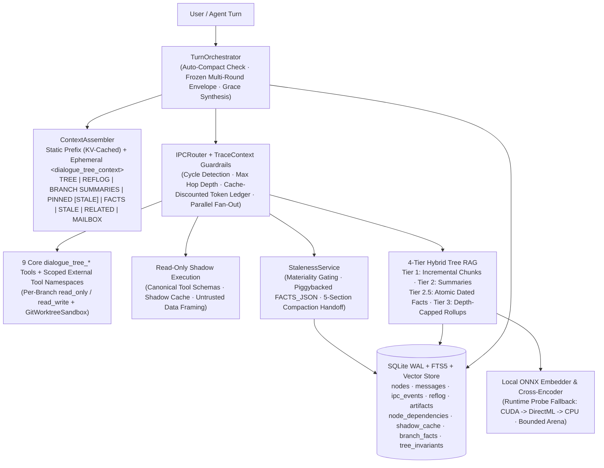

# Chatree

**Hierarchical Actor-Model Dialogue Trees for Bounded-Context, Verifiable, Non-Destructive LLM Conversations**

[](https://www.python.org/downloads/)
[](#artifact-evaluation--reproducibility)
[](#architecture)
[](#cli-mcp-server--optional-demo-ui)

**Chatree** is a local-first Python framework and research testbed that replaces flat linear chat transcripts with **hierarchical actor-model dialogue trees**. Every topic tangent, speculative prototype, or compacted continuation runs as an isolated tree node with copy-on-write prefix inheritance, read-only shadow inspection, causal staleness coherence, dead-end quarantine, non-destructive compaction, and a 4-tier hybrid tree index—keeping active working context $O(1)$-bounded while retaining verbatim ancestor provenance.

---

## Table of Contents

1. [Motivation & Design Principles](#motivation--design-principles)
2. [Architecture](#architecture)
3. [Core Primitives (`dialogue_tree_*`)](#core-primitives-dialogue_tree_)
4. [Systems Capability Comparison](#systems-capability-comparison)
5. [Empirical Evaluation](#empirical-evaluation)
6. [Limitations & Threats to Validity](#limitations--threats-to-validity)
7. [Installation & Python SDK Quickstart](#installation--python-sdk-quickstart)
8. [Artifact Evaluation & Reproducibility](#artifact-evaluation--reproducibility)
9. [CLI, MCP Server & Optional Demo UI](#cli-mcp-server--optional-demo-ui)
10. [Repository Structure](#repository-structure)
11. [Citation](#citation)

---

## Motivation & Design Principles

Long-horizon conversational agents face four coupled failure modes in flat threads:
1. **Context growth & dead-end pollution:** Abandoned explorations remain permanently interleaved with settled decisions.
2. **Lossy compression:** Destructive rolling summarization (e.g., in-place `/compact`) discards fine-grained verbatim details once compacted.
3. **Silent causal drift:** Revising an earlier decision does not notify downstream workstreams that previously depended on it.
4. **KV-cache thrashing:** Mutating system prompts or interleaved histories invalidates provider prefix caches at byte 0.

Chatree addresses these through six orthogonal invariants:
- **Immutable Static Prefix + Ephemeral Tail Envelope:** Static branch history (`build_static_prefix`) is never mutated; dynamic topology (`TREE`), temporal history (`REFLOG`), `BRANCH SUMMARIES`, `PINNED` invariants, Tier-2.5 `FACTS`, `STALE` alerts, `RELATED` pointers, and `MAILBOX` handoffs are injected solely into the ephemeral `<dialogue_tree_context>` tail on the newest user turn, preserving byte-0 prefix caching (including Anthropic's 4-breakpoint fork-boundary caching and canonical tool-schema preservation on shadow turns).
- **Read-Only Shadow Turns & Semantic Memoization:** Cross-branch reads (`dialogue_tree_query_branch`) return cached Tier-2 summaries at 0 LLM tokens when clean, or execute an isolated read-only shadow turn against the target's verbatim turns without polluting either branch's history. Repeat queries hit `shadow_cache` via exact hash or identifier-guarded semantic cosine match ($\ge 0.90$).
- **Materiality-Gated Transitive Staleness & `PINNED` Coherence:** Reopening and modifying a branch classifies edits as *cosmetic* (minor `v1.1`, zero cascade) vs. *material* (major `v2.0` + identifier/polarity delta), propagating multi-hop staleness alerts (`A -> B -> C`) and flagging affected tree-wide `PINNED` invariants as `[STALE]`.
- **Dead-End Quarantine (`ARCHIVED`):** Scrapped branches archived via `dialogue_tree_archive_branch` remain auditable in SQLite but are excluded by default from all four RAG tiers (`chunk`, `summary`, `fact`, `rollup`), `BRANCH SUMMARIES`, and active atomic fact queries.
- **4-Tier Hybrid Tree Index with Piggybacked Temporal Facts:** Combines Tier-1 contextual turn chunks (`[Path | Goal]`, incremental $O(1)$ tail indexing), Tier-2 lazy summaries, Tier-2.5 piggybacked branch-scoped atomic dated facts (`FACTS_JSON:` with absolute calendar date resolution, zero extra LLM calls), and Tier-3 depth-capped subtree rollups (`max_rollup_depth=8`) via SQLite FTS5 BM25 + vectorized NumPy cosine RRF + local ONNX cross-encoder reranking (with runtime GPU smoke-test fallback `CUDA -> DirectML -> CPU`).
- **Non-Destructive Auto-Compaction (`B1 -> B2 -> ... -> Bk`):** When a branch crosses its token threshold, Chatree commits a structured 5-section anchor-preserving handoff on the warm KV prefix and spawns a linked continuation branch (with an automatic savings guard preventing expansion), leaving every ancestor verbatim and shadow-queryable indefinitely.

---

## Architecture



---

## Core Primitives (`dialogue_tree_*`)

All built-in primitives are namespaced under `dialogue_tree_*` to guarantee zero collision with external/MCP tool packs (`ct.tool_namespace("...")`):

| Tool | Purpose | Allowed in Shadow? | State Effect |
|---|---|:---:|---|
| `dialogue_tree_create_branch` | Spawn child branch (`fork`, `slice`, or `clean`) with optional `autonomous=True` sub-turn | No | Creates node, optionally switches `HEAD` |
| `dialogue_tree_send_to_branch` | Deliver message/versioned artifacts (`slug@vN`) to mailbox; `finish=True` squash-merges to parent | No | Writes mailbox / completes child |
| `dialogue_tree_query_branch` | Known-ID inspection: omit `prompt` for 0-token cached summary; pass `prompt` for read-only shadow Q&A | Yes | Read-only (records dependency edge) |
| `dialogue_tree_search_branches` | 4-tier hybrid BM25 + vector RRF search across `all`, `ancestors`, `subtree`, or `siblings` | Yes | Read-only |
| `dialogue_tree_search_and_query` | Single-hop compound search + parallel read-only shadow fan-out for unknown branch IDs | No | Read-only |
| `dialogue_tree_switch_branch` | Git-style `HEAD@{k}` / `back` / `forward` navigation with destination preview & 1-turn `follow_up_prompt` | No | Updates `HEAD` & reflog |
| `dialogue_tree_compact_branch` | Non-destructive 5-section anchor compaction into linked continuation child (source kept verbatim) | No | Spawns continuation, completes source |
| `dialogue_tree_pin_invariant` | Pin/update/unpin up to 8 tree-wide invariants (`read_write` only; auto-flagged `[STALE]` on source edit) | No | Updates `tree_invariants` |
| `dialogue_tree_archive_branch` | Quarantine dead-end non-root branch (`status=ARCHIVED`) from all 4 RAG tiers and return `HEAD` to parent | No | Archives branch, updates rollups |

---

## Systems Capability Comparison

| Capability | Full-Context Linear | Sliding Window | Flat Hybrid RAG | Mem0 | Letta / MemGPT | Zep / Graphiti | Context-Folding | MIT RLM | **Chatree** |
|---|:---:|:---:|:---:|:---:|:---:|:---:|:---:|:---:|:---:|
| Bounded $O(1)$ working context | ✗ | ✓ | ✓ | ✓ | ✓ | ✓ | ✓ | Partial | **✓** |
| Lossless verbatim ancestor recall | ✓ (until limit) | ✗ | Partial (chunks) | ✗ (distilled) | Partial (archival) | Partial | ✗ (folded) | ✓ (REPL) | **✓ (Shadow)** |
| Explicit branching & dead-end quarantine | ✗ | ✗ | ✗ | ✗ | ✗ | ✗ | Partial | ✗ | **✓ (`ARCHIVED`)** |
| Materiality-gated causal staleness | ✗ | ✗ | ✗ | ✗ | ✗ | Temporal edges | ✗ | ✗ | **✓ (Transitive)** |
| Non-destructive compaction chain | ✗ | ✗ | ✗ | ✗ | Destructive | ✗ | Destructive | N/A | **✓** |
| Piggybacked atomic temporal facts | ✗ | ✗ | ✗ | ✓ (separate LLM) | ✗ | ✓ (KG) | ✗ | ✗ | **✓ (0 extra calls)** |
| Provider KV-cache prefix preservation | ✓ (~95%) | ✗ (~7%) | ✗ (~0–2%) | ✗ (~0%) | Partial | ✗ | Partial | ✗ (0%) | **✓ (~50–76%)** |
| Git-style `HEAD@{k}` reflog navigation | ✗ | ✗ | ✗ | ✗ | ✗ | ✗ | ✗ | ✗ | **✓** |

---

## Empirical Evaluation

All live benchmarks below were executed with `deepseek/deepseek-chat` and zero-API-cost local ONNX retrieval (`BAAI/bge-small-en-v1.5` 384-dim embeddings + `Xenova/ms-marco-MiniLM-L-6-v2` cross-encoder) against **unmodified upstream packages** (`mem0ai==2.2.1`, MIT `rlms==0.1.3`) on official benchmark datasets (`locomo10.json`, `longmemeval_s_cleaned.json`) with `use_provided_summaries=False`. Raw logs, manifests, CSVs, and LaTeX tables are stored in [`results/deepseek_eval/`](results/deepseek_eval/).

### 1. Official LoCoMo (ACL 2024 — Stratified 10 Conversations, 245 Balanced QAs)

Stratified macro-balanced selection (`5 QAs/category/conv` across all 10 conversations; 272 sessions total; exact paired filtering over the 245 target QA IDs):

| System | `n` | Accuracy (95% Bootstrap CI) | Single-Hop | Multi-Hop | Temporal | Open-Domain | Adversarial† | Peak Tok | KV Cache | McNemar `p` vs. v2 |
|---|---:|---:|---:|---:|---:|---:|---:|---:|---:|---:|
| `chatree_two_tier` (v2, pre-Tier-2.5) | 245 | **64.5%** `[58.4, 70.6]` | 78.0% | 50.0% | 52.0% | 44.4% | 96.0% | **4,250** | **75.5%** | ref |
| `chatree_two_tier_v3` (+Tier-2.5 Facts)‡ | 134 | **68.7%** `[60.5, 76.1]` | 70.0% | **79.4%** | **77.8%** | 45.8% | 60.0%† | **4,913** | 59.8% | **0.0125\*** |
| `mem0_official` (`mem0ai==2.2.1`) | 245 | **69.0%** `[63.3, 75.1]` | 78.0% | 66.0% | 74.0% | 53.3% | 72.0% | 874 | 0.1% | 0.2353 |
| `full_context_linear` | 245 | **67.3%** `[61.6, 73.1]` | **88.0%** | **82.0%** | 68.0% | **55.6%** | 42.0%† | 35,097 | 95.4% | 0.5201 |
| `rlm_official` (`rlms==0.1.3`)‡ | 117 | **66.7%** `[58.1, 75.2]` | 76.0% | 64.0% | **80.0%** | 55.0% | 54.5%† | 28,166 | 0.0% | 0.1845 |
| `flat_hybrid_rag` | 245 | 44.1% `[37.5, 50.2]` | 46.0% | 26.0% | 40.0% | 33.3% | 74.0% | 725 | 2.3% | **<0.0001\*** |
| `tree_summary_only` (Context-Folding) | 245 | 38.8% `[32.6, 45.3]` | 40.0% | 32.0% | 16.0% | 31.1% | 74.0% | 1,480 | 11.9% | **<0.0001\*** |

> **Methodological Notes:**
> - **`chatree_two_tier` vs. baselines (`n=245`):** Statistically outperforms `flat_hybrid_rag` (+20.4 pts, $p < 10^{-4}$) and `tree_summary_only` (+25.7 pts, $p < 10^{-4}$), and reaches statistical parity with `full_context_linear` ($p = 0.5201$) at **8.3× smaller peak context** (`4,250` vs. `35,097`).
> - **Tier-2.5 atomic facts ablation (`v3` vs. `v2`):** Adding piggybacked dated atomic facts delivered a statistically significant overall lift ($p = 0.0125$ on paired `n=134`), raising `multi_hop` by **+29.4 pts** (`50.0% -> 79.4%`) and `temporal` by **+25.8 pts** (`52.0% -> 77.8%`).
> - **†Adversarial rubric caveat (fixed in codebase, pending off-peak re-judge):** During audit of `v3`, we discovered our initial binary abstention judge penalized truthful false-premise corrections (e.g., *"Caroline did not run the charity race — Melanie did"* scored `0`) and passed `adversarial_answer` under `Ground Truth:`. This bug has been fixed in [`external_benchmarks.py`](src/chatree/eval/external_benchmarks.py) with `ExternalBenchmarkRunner.rejudge_checkpoint()` ready for off-peak re-scoring across all systems.
> - **‡Partial checkpoint status:** `rlm_official` (`n=117`) and `chatree_two_tier_v3` (`n=134`) paused cleanly on API balance exhaustion; McNemar $p$-values above are computed strictly over their exact paired QA-ID intersections with `chatree_two_tier`.

### 2. Official LongMemEval-S (ICLR 2025 — 30 Stratified Items, ~48 Sessions / ~115k Tokens Each)

Stratified across all 6 official categories (5 items/category, 1,429 sessions ingested total):

| System | Accuracy (95% CI) | Single-User | Single-Asst | Pref | Knowledge-Update | Temporal | Multi-Session | Peak Tok | Query USD (+Ingest) | KV Cache | p50 / p95 ms | McNemar `p` |
|---|---:|---:|---:|---:|---:|---:|---:|---:|---:|---:|---:|---:|
| `chatree_two_tier` | **63.3%** `[46.7, 80.0]` | 80.0% | 60.0% | **60.0%** | 80.0% | 60.0% | 40.0% | **6,927** | **\$0.162** (+\$0.629) | **49.6%** | 6.19s / **8.15s** | ref |
| `full_context_linear` | **70.0%** `[53.3, 86.7]` | **100.0%** | **100.0%** | 20.0% | **100.0%** | 60.0% | 40.0% | 108,772 | \$0.882 (+\$0.000) | 0.0% | **2.42s / 4.76s** | 0.7744 |
| `rlm_official` | **70.0%** `[53.3, 86.7]` | 80.0% | **100.0%** | 40.0% | 80.0% | **80.0%** | 40.0% | 21,373 | \$0.375 (+\$0.000) | 0.0% | 11.25s / 31.98s | 0.7539 |
| `flat_hybrid_rag` | 40.0% `[23.3, 56.7]` | 80.0% | 20.0% | 0.0% | 80.0% | 20.0% | 40.0% | 770 | \$0.005 (+\$0.000) | 0.0% | 9.17s / 276.3s* | 0.0654 |

> **Key Takeaways:** Chatree operates at **15.7× smaller peak context** than `full_context_linear` (`6,927` vs. `108,772`) and **3.1× smaller** than `rlm_official` (`21,373`), achieves **49.6% KV-cache hit** vs. **0.0%** across all three baselines, leads all systems on `single-session-preference` (**60.0%** vs. 20–40%), and achieves **3.9× faster p95 latency** than `rlm_official` (`8.15s` vs. `31.98s`). However, on this underpowered `n=30` split ($\pm 16.7\%$ CI), `chatree_two_tier` still trails Linear and RLM by −6.7 pts on single-session recall, and single-QA cold ingest (`\$0.629`) dominates total single-question cost (`\$0.791` vs. RLM `\$0.375`). *(`flat_hybrid_rag`'s `276.3s` p95 was an ONNX CPU-thrashing artifact prior to our bounded-arena + DirectML GPU fix and will be re-measured cleanly.)*

### 3. Live Multi-Turn Jump-Around & Infinite-Context Compaction (Tracks 5 & 6)

- **Track 5 — Live 18-Turn Jump-Around Chatbot ([`exp5_jump_around.csv`](results/deepseek_eval/exp5_jump_around.csv)):** `chatree_live` achieved **100.0% recall**, **100.0% navigation accuracy** (4 autonomous branches, 4 reflog jumps), **0.0% dead-end leakage** (vs. 33.3% for `linear` and `rlm_official`), **0.967 LLM-judge score**, and **73.5% KV-cache hit**. Importantly, over this short 18-turn horizon (~8k linear tokens), `chatree_live` incurred a clear **short-horizon tax** (`9,640` vs. `8,194` peak tok; `236.6k` vs. `73.6k` total input tokens; `\$0.033` vs. `\$0.006`; `9.11s` vs. `3.74s` p50 latency), confirming that dialogue-tree orchestration pays off primarily at long horizons, high branching factor, or context overflow—not short single-thread sessions.
- **Track 6 — Live 4-Generation Auto-Compaction ([`exp6_compaction_live.json`](results/deepseek_eval/exp6_compaction_live.json)) & Deterministic Benchmark ([`compaction_bench.py`](src/chatree/eval/compaction_bench.py)):** Verified flat $O(1)$ post-compaction working context (`1,537 -> 1,593 -> 1,588` tokens across 4 generations), `54.1%` KV-cache hit, immutable Gen-1 preservation, and 100% verbatim recall. The upgraded `CompactionBenchmarkRunner` now benchmarks `chatree_non_destructive` head-to-head against `destructive_rolling` and `sliding_window` on **both** anchored decisions and **un-anchored Turn-1 verbatim diagnostics**.

---

## Limitations & Threats to Validity

In accordance with academic artifact-evaluation standards, we explicitly document known limitations and active research gaps:

1. **Benchmark pipeline vs. live orchestrator split:** External benchmarks (`ChatreeSystemAdapter`) use a structured 3-stage pipeline (`tree.ask` → Hop-2 planner → synthesizer), whereas interactive users run `TurnOrchestrator` with autonomous tool calling. Tier-2.5 ephemeral `FACTS` hints are now wired into `TurnOrchestrator`, but end-to-end live-agent LoCoMo/LongMemEval scores remain to be measured.
2. **Single-model & self-judging bias:** Live evaluations thus far used `deepseek/deepseek-chat` for both generation and LLM judging on a single seed. The runner now supports `--judge-model <cross-family-model>` (e.g., Claude / GPT-4o) for cross-family judge audits and Cohen's $\kappa$ validation.
3. **Context-overflow regime (`LongMemEval-M`, >1M tokens):** Existing live runs fit inside DeepSeek's 128k window, where full-context linear + prompt caching is strong. `LongMemEval-M` support (`--lme-split m`, ~500 sessions / ~1.2M tokens) is implemented and ready for off-peak evaluation.
4. **Hosted-API KV-cache TTL:** On hosted providers (Anthropic, DeepSeek, OpenAI), server-side KV caches expire after ~5–10 minutes; non-destructive compaction preserves *verbatim message prefixes* indefinitely (enabling warm cache hits within TTL and instant reload on self-hosted RadixAttention / LMCache engines), not permanent hosted VRAM residency.
5. **Single-process SQLite storage & $O(N)$ vector scan:** `SQLiteRepository` uses WAL + in-process `asyncio.Lock` and scans per-tree embedding BLOBs via vectorized NumPy (`mat @ q`, <1 ms at 5k chunks). Multi-tenant / 100k+ chunk deployments will require an ANN index (`sqlite-vec` / HNSW) or a Postgres/`pgvector` `StorageBackend` implementation.
6. **Token estimation & sandbox scope:** Context-overflow and auto-compact guards use a fast character-ratio heuristic (`len(text) // 4`) rather than exact model tokenizers, and `GitWorktreeSandbox` isolates git working trees without OS/container/network sandboxing.

---

## Installation & Python SDK Quickstart

Requires **Python 3.12+** and [`uv`](https://docs.astral.sh/uv/) (or `pip`).

```bash
# Core framework (SQLite WAL + FTS5 + SDK + CLI + MCP, zero external API keys needed)
uv sync

# Full install with LiteLLM multi-provider routing, local ONNX RAG, sqlite-vec, and FastAPI server
uv sync --all-extras --extra local-rag
```

Optional extras in [`pyproject.toml`](pyproject.toml):
- `chatree[litellm]` — DeepSeek, Anthropic, OpenAI, Gemini, OpenRouter, Ollama, vLLM/SGLang
- `chatree[local-rag]` — Local ONNX embeddings (`BAAI/bge-small-en-v1.5`) & cross-encoder reranking (`fastembed`), with automatic `CUDA -> DirectML -> CPU` runtime fallback
- `chatree[vec]` — Native `sqlite-vec` C extension
- `chatree[server]` — Optional FastAPI REST + SSE server

```python
import asyncio
from chatree import ArtifactInput, Chatree, ChatreeConfig, GuardrailPolicy

async def main() -> None:
    cfg = ChatreeConfig(
        db_path="./data/chatree.db",
        default_model="mock/chatree-demo",  # swap for "deepseek/deepseek-chat", "anthropic/claude-sonnet-4-5", etc.
        guardrails=GuardrailPolicy(auto_compact_enabled=True, auto_compact_threshold_tokens=24_000),
    )
    async with Chatree.open(cfg.db_path, config=cfg) as ct:
        tree = await ct.create_tree("Nebula API Gateway")
        root = await tree.root()

        await root.chat("Hard SLO is P99_LATENCY_120MS on Rust/Axum.")
        await tree.pin("slo", "P99_LATENCY_120MS", source_node_id=root.id)

        # Spawn isolated branch & commit versioned artifact
        auth = await root.spawn("Design JWT signing and TTL", title="Auth Design", mode="clean")
        await auth.chat("Settled on ED25519_SIGNING and JWT_TTL_5M_ROTATING.")
        await auth.finish(
            summary="ED25519_SIGNING + JWT_TTL_5M_ROTATING.",
            artifacts=[ArtifactInput(slug="auth.md", title="Auth Spec", content="# Auth\nED25519_SIGNING")],
            auto_commit=True,
        )

        # Quarantine a scrapped speculative prototype from all 4 RAG tiers
        dead = await root.spawn("Test GraphQL federation", title="GraphQL Prototype", mode="clean")
        await dead.chat("GRAPHQL_FEDERATION_V0 adds 24 hops.")
        await dead.archive(reason="Violates P99_LATENCY_120MS SLO")

        # Read-only shadow turn against Auth Design (0 mutation, memoized in shadow_cache)
        shadow = await root.request(auth.id, prompt="What exact JWT TTL is active?")
        print(shadow["answer"])

        # Non-destructive compaction preserving root verbatim for future shadow queries
        cont, meta = await root.compact(keep_recent_turns=2, reason="Checkpoint Phase 1")
        print(f"Compacted {meta['tokens_before']} -> {meta['tokens_after']} tokens into {cont.id}")

asyncio.run(main())
```

Runnable examples: [`examples/01_quickstart_sdk.py`](examples/01_quickstart_sdk.py) through [`examples/05_publishable_eval_and_sota.py`](examples/05_publishable_eval_and_sota.py).

---

## Artifact Evaluation & Reproducibility

### Step 1: Zero-Key Functional Verification (~40s)
Runs all **65 unit and integration tests** covering IPC guardrails, copy-on-write forks, shadow memoization, materiality-gated transitive staleness, `dialogue_tree_archive_branch` dead-end quarantine, GPU runtime fallback, Tier-2.5 atomic facts, `PINNED` staleness, non-destructive compaction savings guards, negation-aware scoring, LoCoMo/LongMemEval loaders, and Track 6 compaction benchmarks:

```bash
uv run pytest -v
```

### Step 2: Offline Mock Benchmark Reproduction (Zero Cost)
```bash
uv run chatree eval --suite all --csv-out ./out/suite.csv --grpo-out ./out/grpo.jsonl
uv run chatree eval --ablation-matrix --latex-out ./out/ablations.tex
uv run chatree eval --crossover-ks 2,4,8 --latex-out ./out/crossover.tex
uv run chatree eval --jump-around --out-dir ./out/jump
```

### Step 3: Live External & Overflow Benchmarks (Requires `DEEPSEEK_API_KEY` or LiteLLM Provider Key)
Copy [`.env.example`](.env.example) to `.env` and set your API key (never committed to git). Datasets auto-download into `data/benchmarks/` (gitignored):

```bash
# Re-judge saved LoCoMo checkpoints with the fixed adversarial rubric or a cross-family judge
uv run python scripts/run_publishable_deepseek_eval.py \
  --locomo-convs 10 --locomo-per-cat 5 \
  --rejudge-locomo-ckpt results/deepseek_eval/exp3_locomo.ckpt.jsonl \
  --judge-model deepseek/deepseek-chat

# Track 3 (LoCoMo 10 convs / 245 QAs), Track 4 (LongMemEval-S or LongMemEval-M >1M overflow), & Track 6 (Compaction)
uv run python scripts/run_publishable_deepseek_eval.py \
  --tracks 3,4,6 --paper-baselines \
  --locomo-convs 10 --locomo-per-cat 5 \
  --lme-split m --lme-per-cat 10 \
  --concurrency 4
```

Every external run emits crash-safe `*.ckpt.jsonl` checkpoints, paired `McNemar` and bootstrap CI tables (`*.md`, `*.csv`, `*.tex`), and exact provenance manifests (`*_manifest.json` recording model IDs, embedder/reranker versions, git SHA, token totals, and USD costs).

---

## CLI, MCP Server & Optional Demo UI

```bash
# CLI tree operations & portable human-greppable .dialogue/ backup
uv run chatree init "Distributed Caching"
uv run chatree trees
uv run chatree ask <tree_id> "What TTL did we select?"
uv run chatree compact <tree_id> --keep-recent 4
uv run chatree dump <tree_id> ./.dialogue/cache-tree
uv run chatree load ./.dialogue/cache-tree
uv run chatree export <tree_id> --out ADR.md

# Expose local Chatree store to external coding agents via MCP (stdio JSON-RPC 2.0)
uv run chatree mcp

# Optional FastAPI + React reference UI
uv run chatree serve --port 8001
cd demo/ui && pnpm install && pnpm dev
```

---

## Repository Structure

```text
Chatree/
├── src/chatree/
│   ├── config.py                  # ChatreeConfig, GuardrailPolicy, RagConfig, AblationConfig
│   ├── tools.py                   # 9 dialogue_tree_* core schemas, STATIC_SYSTEM_PROMPT, ToolRegistry
│   ├── engine/
│   │   ├── orchestrator.py        # TurnOrchestrator (auto-compact, frozen envelope, grace synthesis)
│   │   ├── context.py             # Static prefix builder + ephemeral <dialogue_tree_context>
│   │   ├── ipc.py                 # IPCRouter (parallel fan-out, shadow turns, compaction, archive, pin)
│   │   ├── rag.py                 # 4-tier hybrid Tree RAG (chunks, summaries, atomic facts, rollups)
│   │   ├── staleness.py           # Materiality gating, piggybacked FACTS_JSON, 5-section compactor
│   │   ├── reflog.py              # Git-style HEAD@{k} / back / forward navigation
│   │   ├── actors.py              # Non-blocking async background child actors
│   │   └── guardrails.py          # Cycle, hop-depth, and cache-discounted token-budget ledger
│   ├── providers/                 # LiteLLMProvider, MockLLMProvider, FastEmbed ONNX (GPU fallback)
│   ├── storage/                   # SQLite WAL/FTS5/vector schema, migrations, portable .dialogue/ store
│   ├── sdk/client.py              # High-level Chatree / DialogueTree / NodeHandle async SDK
│   ├── eval/                      # Tracks 1-6 runners, SOTA adapters (Mem0/RLM/Letta/Graphiti), stats
│   ├── cli.py / mcp_server.py     # CLI entrypoint & zero-dependency MCP stdio server
│   └── server/                    # Optional FastAPI REST + SSE adapter
├── demo/ui/                       # Optional React + TypeScript IDE-style tree explorer
├── examples/                      # 5 runnable SDK, custom-tool, ablation, and eval scripts
├── scripts/                       # Publishable DeepSeek / multi-provider evaluation runner
├── results/deepseek_eval/         # Reproducible benchmark tables, LaTeX exports, and manifests
└── tests/                         # 65 automated unit & integration tests (zero API keys required)
```

---

## Citation

If you use Chatree or its evaluation harness in academic work, please cite:

```bibtex
@software{chatree2026,
  title  = {Chatree: Hierarchical Actor-Model Dialogue Trees for Bounded-Context, Verifiable LLM Conversations},
  author = {Shervin},
  year   = {2026},
  version = {0.2.0},
  url    = {https://github.com/shervinemp/Chatree}
}
```
