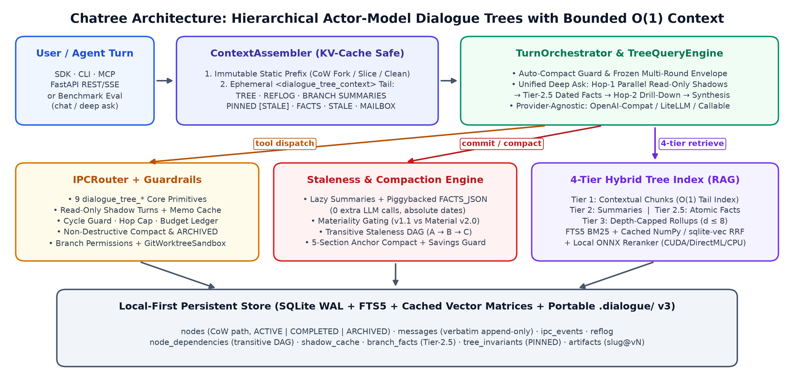
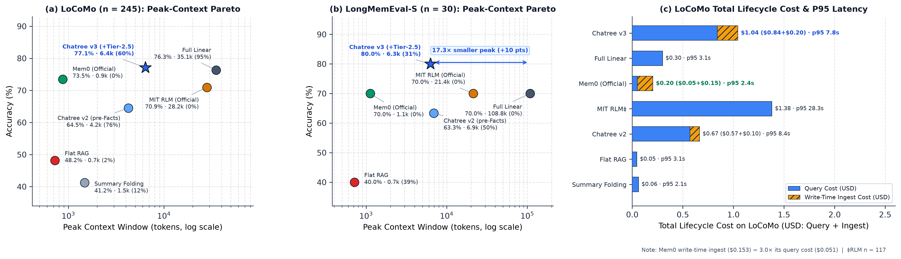
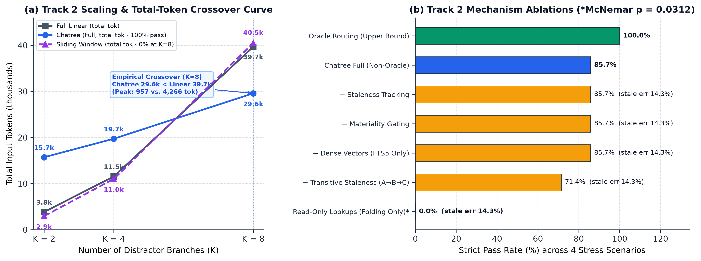

# Chatree: Hierarchical Actor-Model Dialogue Trees for Bounded-Context, Verifiable, Non-Destructive LLM Conversations

**Shervin** · Technical Report (v0.2.0) · [Compiled PDF](chatree_paper.pdf) · [LaTeX Source](chatree_paper.tex) · [BibTeX](references.bib) · [Reproducible Results](../results/deepseek_eval/)

---

## Abstract

Long-horizon Large Language Model (LLM) conversations suffer from four coupled failure modes in flat linear transcripts: unbounded context growth, dead-end pollution from abandoned explorations, lossy context compaction that discards verbatim provenance, and prefix KV-cache thrashing when dynamic state is injected into the prompt. We present **Chatree**, a local-first, provider-agnostic framework that structures conversations as **hierarchical actor-model dialogue trees**. Each topic tangent, speculative prototype, or compacted continuation runs as an isolated tree node backed by copy-on-write prefix inheritance, read-only shadow inspection with semantic memoization, materiality-gated transitive staleness tracking, dead-end quarantine (`ARCHIVED`), non-destructive continuation compaction, and a 4-tier hybrid tree index augmented with zero-extra-call piggybacked temporal facts (Tier-2.5). Dynamic topology and memory metadata are injected exclusively into an ephemeral tail envelope, preserving immutable static prefixes for provider KV caching.

We evaluate Chatree across eight experimental tracks on `deepseek/deepseek-chat` with local ONNX retrieval against unmodified upstream baselines including `mem0ai==2.2.1`, MIT `rlms==0.1.3`, full-context linear, sliding window, flat hybrid RAG, and summary-only context folding:
- **Official LoCoMo (ACL 2024, $n=245$ balanced QAs, fixed adversarial rubric):** Chatree v3 ranks **#1 overall at 77.1%** (95% CI `[71.8, 82.5]`), surpassing `full_context_linear` (`76.3%`) at **5.5× smaller peak context** (`6,390` vs. `35,097` tokens), `mem0_official` (`73.5%`, **+14.0 pts on multi-hop**, `60.0%` vs. `0.1%` KV cache hit), `rlm_official` (`70.9%`), `flat_hybrid_rag` (`48.2%`, $p < 10^{-4}$), and `tree_summary_only` (`41.2%`, $p < 10^{-4}$). Piggybacked Tier-2.5 dated facts deliver a **+12.6 pt** lift over v2 (McNemar $p = 0.0001^*$).
- **Official LongMemEval-S (ICLR 2025, $n=30$, ~115k-token histories, 6 systems):** Chatree v3 ranks **#1 overall at 80.0%** (`[66.7, 93.3]`) vs. `70.0%` for `full_context_linear`, `mem0_official` (**+40.0 pts on `knowledge-update`**, **28% lower total lifecycle cost** `\$1.119` vs. `\$1.555`), and `rlm_official`, at **17.3× smaller peak context** (`6,295` vs. `108,772` tokens), **3.8× lower query cost** than linear, and **4.2× faster p95 latency** than RLM.
- **Track 7 (Non-Monotonic Engineering & Spec-Reversal, $n=36$, 80 sessions):** Chatree v3 scores **100.0% (36/36)** across spec reversals, dead-end quarantine, downstream staleness, verbatim recovery under noise, and cross-branch synthesis—statistically outperforming `rlm_official` (`77.8%`, $p=0.0078^*$) and `flat_hybrid_rag` (`36.1%`, $p<10^{-4}$) and surpassing `tree_summary_only` (`88.9%`).
- **Track 8 (Structural Simulation Trace & Live Micro-Diagnostic Proof vs. Mem0):** A zero-token real-framework execution trace (`\$0.00`) tracing real `Chatree` alongside real `mem0ai==2.2.1` over a localhost proxy verifies **82.5% vs. 0.7%** turn-to-turn byte-0 LCP prefix cacheability (**−69.4%** billed input tokens), exposes `mem0ai==2.2.1`'s **`33,653`-char (~8,413-token)** `ADDITIVE_EXTRACTION_PROMPT` per `add()` call, and separates Chatree **8/8 (100%)** vs. Mem0 **0/8 (0%)** under identical lossy distillation. Live off-peak verification (`deepseek/deepseek-chat`, `~\$0.015`) confirms **8/8 (100.0%, 0 leaks, 2/2 structural stale flags, 78.7–81.9% KV cache)** vs. `mem0_official` **6/8 (75.0%, 1 production dead-end leak, 0/2 stale flags, 0.0% KV cache)**.
- **Track 6 (9-Generation Infinite-Context Compaction):** Chatree's non-destructive continuation chain achieves **100.0% recall** on both anchored decisions and **un-anchored Turn-1 verbatim diagnostics** at `1,727` peak tokens, while destructive rolling compaction drops to **0.0%** on un-anchored details.
- **Tracks 1, 2 & 5:** `8/8 (100%)` strict pass across all 5 stress families, an empirical total-token crossover below `linear` at $K=8$ (`29.6k` vs. `39.7k` total tokens; `957` vs. `4,266` peak tokens), statistically significant shadow-turn ablation (`0.0%` without shadow turns, $p=0.0312^*$), and **100.0% recall / 1.00 judge / 82.7% KV cache** on natural-prompt live jump-around sessions.

---

## 1. Introduction

Interactive software engineering, research synthesis, and multi-session assistants routinely span dozens of topic branches, speculative explorations, mid-stream design revisions, and hundreds of thousands of tokens. Representing these workflows as a single append-only linear transcript induces four coupled pathologies:

1. **Context Growth & Attention Degradation:** Unrelated tangents accumulate linearly per turn, inflating prefill cost and causing *lost-in-the-middle* recall failures (Liu et al., 2024).
2. **Dead-End Pollution:** Abandoned explorations stay permanently interleaved with settled decisions, increasing distractor leakage.
3. **Lossy Compaction:** In-place rolling summarization erases un-anchored verbatim facts (ports, offsets, edge-case dates) that were not recognized as salient when compaction ran.
4. **Silent Causal Drift & KV-Cache Thrashing:** Revising an earlier decision emits no invalidation signal to dependent threads, while mutating system prompts or injecting dynamic memory near byte 0 destroys provider KV-cache prefixes (Zheng et al., 2024).

Chatree replaces the flat transcript with a **process tree of isolated dialogue actors** (Hewitt et al., 1973) persisted in a local-first SQLite WAL/FTS5 store and queried via a unified multi-hop `TreeQueryEngine`.

---

## 2. Systems Capability Comparison

| Capability | Full Linear | Sliding Window | Flat RAG | Mem0 | Letta / MemGPT | Zep / Graphiti | Context-Folding | MIT RLM | **Chatree** |
|---|:---:|:---:|:---:|:---:|:---:|:---:|:---:|:---:|:---:|
| Bounded $O(1)$ working context | ✗ | ✓ | ✓ | ✓ | ✓ | ✓ | ✓ | Partial | **✓** |
| Lossless verbatim ancestor recall | ✓* | ✗ | Partial | ✗ | Partial | Partial | ✗ | ✓ | **✓ (Shadow)** |
| Branching & dead-end quarantine | ✗ | ✗ | ✗ | ✗ | ✗ | ✗ | Partial | ✗ | **✓ (`ARCHIVED`)** |
| Materiality-gated causal staleness | ✗ | ✗ | ✗ | ✗ | ✗ | Temporal | ✗ | ✗ | **✓ (Transitive)** |
| Non-destructive compaction chain | ✗ | ✗ | ✗ | ✗ | Destructive | ✗ | Destructive | N/A | **✓** |
| Piggybacked dated atomic facts | ✗ | ✗ | ✗ | Separate LLM | ✗ | KG | ✗ | ✗ | **✓ (0 extra calls)** |
| KV-cache prefix preservation | ✓ | ✗ | ✗ | ✗ | Partial | ✗ | Partial | ✗ | **✓ (31–83%)** |
| Git-style `HEAD@{k}` reflog | ✗ | ✗ | ✗ | ✗ | ✗ | ✗ | ✗ | ✗ | **✓** |

*\*Full-context linear retains verbatim history only until the model's context window overflows.*

---

## 3. Architecture


*Figure 1: End-to-end Chatree architecture uniting immutable copy-on-write prefixes, ephemeral tail envelopes, bidirectional IPC with read-only shadow turns, materiality-gated transitive staleness, 4-tier hybrid tree RAG with piggybacked Tier-2.5 atomic facts, and non-destructive compaction over a local-first SQLite WAL store.*

### 3.1 Formal Dialogue Tree State Model

A Chatree workspace is a tuple $\mathcal{T} = (V, E, H, \mathcal{R}, \mathcal{A}, \mathcal{F}, \mathcal{I}, \mathcal{D})$:
- **$V, E$:** Rooted tree of dialogue actor nodes with materialized paths, lifecycle status $\sigma(v) \in \{\text{ACTIVE}, \text{COMPLETED}, \text{ARCHIVED}\}$, append-only verbatim messages $M(v)$, lazy Tier-2 summary $s(v)$ with version $\nu(v)$ and dirty flag $\delta(v)$, tool permission $\pi(v) \in \{\text{read\_only}, \text{read\_write}\}$, and inheritance mode $\mu(v) \in \{\text{root}, \text{fork}, \text{slice}, \text{clean}\}$.
- **$H, \mathcal{R}$:** Active `HEAD` pointer and Git-style reflog supporting `HEAD@{k}`, `back`, and `forward` jumps with one-shot orientation cues.
- **$\mathcal{A}$:** Versioned artifact blackboard (`slug@vN`) storing exact code, schemas, and specs out-of-band.
- **$\mathcal{F}$:** Branch-scoped Tier-2.5 provenance-linked atomic temporal facts `(fact_text, entities, resolved_date, node_id, source_msg_seq)`.
- **$\mathcal{I}$:** Bounded tree-wide `PINNED` invariants (up to 8 entries) with source-revision tracking `(source_node_id, source_summary_version, source_msg_seq)`.
- **$\mathcal{D}$:** Directed dependency graph recording $(u \to v, \nu_{\text{seen}}, \text{seq}_{\text{seen}})$ whenever node $u$ reads from node $v$.

### 3.2 KV-Cache-Safe Dual-Zone Context Assembly

When child $c$ spawns from parent $u$ at a safe non-dangling tool-call boundary $k_{\text{fork}}$, its static prompt prefix is constructed copy-on-write:

$$
P(c) = \begin{cases}
P(u) \Vert M_{1..k_{\text{fork}}}(u) \Vert M(c), & \mu(c) = \text{fork}, \\
S_{\text{sys}} \Vert \text{brief}(c) \Vert M_{k_{\text{fork}}-w+1..k_{\text{fork}}}(u) \Vert M(c), & \mu(c) = \text{slice}, \\
S_{\text{sys}} \Vert \text{brief}(c) \Vert M(c), & \mu(c) = \text{clean}.
\end{cases}
$$

$P(c)$ stays **byte-immutable** across turns and multi-round tool loops: `brief(c)` anchors to a frozen `brief_title` captured at node creation, allowing Turn-1 non-blocking auto-titling and piggybacked-exit `TITLE:` refinement (`title_source ∈ {placeholder, auto, user}`) to enrich UI outlines and RAG `[Path | Goal]` headers with 0% KV-cache invalidation. All dynamic state (`TREE`, `REFLOG`, `BRANCH SUMMARIES`, `PINNED [STALE]`, Tier-2.5 `FACTS`, `STALE`, `RELATED`, `MAILBOX`) is injected solely into an ephemeral `<dialogue_tree_context>` tail on the active user message and never persisted into the branch prefix. Multiple concurrent human or agent visitors can navigate independent `HEAD` pointers and reflogs over the same tree via `TreeSession`.

### 3.3 Core Mechanisms

1. **Read-Only Shadow Turns, Compaction-Chain Resolution & Semantic Memoization:** Calling `dialogue_tree_query_branch(target=v, prompt=q)` returns cached summaries at 0 tokens when `prompt` is omitted, checks `shadow_cache` (normalized exact hash + identifier-guarded cosine $\ge 0.90$), or runs an isolated read-only shadow turn over $P(v)$ preserving the canonical tool-schema array (byte-0 KV-cache safety) while blocking mutating tools and wrapping responses in untrusted-data framing. When querying the tip $B_k$ of a compacted continuation chain returns `NOT_FOUND_IN_BRANCH`, the router transparently walks `[Compacted from ancestor ...]` upward across $B_{k-1} \dots B_1$ in one bounded hop, registers the dependency edge, and memoizes the result under $B_k$.
2. **4-Tier Hybrid Tree Index & Zero-Extra-Call Tier-2.5 Facts:** Indexes contextual chunks (Tier 1, incremental $O(1)$ tail), branch summaries generated via role-balanced proportional cold-branch trimming (`_compact_cold_prefix_messages`, `char_budget=7,500`, 0 tool schemas on cold ingest) (Tier 2), piggybacked `FACTS_JSON:` speaker-attributed atomic facts with deterministic calendar weekday anchoring (`enrich_date_with_weekday`) (Tier 2.5, **0 extra LLM calls**), and depth-capped subtree rollups (Tier 3, `max_rollup_depth=8`). Retrieval fuses SQLite FTS5 BM25 + cached pre-normalized NumPy/`sqlite-vec` cosine rankings via RRF (Cormack et al., 2009) plus local ONNX cross-encoder reranking with automatic `CUDA -> DirectML -> CPU` runtime probe fallback and a shared `GLOBAL_ONNX_INFER_LOCK`. Archiving a dead-end branch (`ARCHIVED`) quarantines all 4 tiers by default.
3. **Materiality-Gated Transitive Staleness, Multi-Branch Imports & `PINNED` Coherence:** Spawning a convergence branch with `imports=[...]` (up to 4 non-`ARCHIVED` branches) freezes bounded read-only snapshots into its brief (0% KV invalidation) and auto-registers `node_dependencies` edges in $\mathcal{D}$. Revising a completed branch distinguishes cosmetic edits (`v1.1`, zero cascade) from material revisions (`v2.0` + identifier/numeric/polarity delta), propagating transitive staleness alerts ($A \to B \to C$) over $\mathcal{D}$ and marking affected `PINNED` invariants `[STALE]`.
4. **Non-Destructive Auto-Compaction Chaining:** Commits a structured 5-section anchor handoff on the warm KV prefix and spawns a linked continuation child ($B_1 \to B_2 \to \dots \to B_k$) guarded by an automatic token-savings check (`slice -> clean` step-down if context would not shrink), preserving every prior generation verbatim.
5. **Unified `TreeQueryEngine`:** Shared across live callers (`tree.ask(..., deep=True)`, `dialogue_tree_search_and_query(..., deep=True)`, CLI, MCP, REST, Demo UI) and `ChatreeSystemAdapter`: Hop-1 parallel shadows $\to$ zero-cost Tier-2.5 atomic facts $\to$ selective Hop-2 summary-map drill-down (skipping redundant Hop-2 only on clean high-hit single-hop queries while preserving parallel targets + follow-up queries for multi-hop, counting, temporal, and update queries) $\to$ chronological evidence synthesis.

---

## 4. Empirical Evaluation

All live experiments run on `deepseek/deepseek-chat` with local ONNX GPU retrieval (`BAAI/bge-small-en-v1.5` + `Xenova/ms-marco-MiniLM-L-6-v2` on DirectML RTX 4080), `use_provided_summaries=False`, and unmodified upstream `mem0ai==2.2.1` and MIT `rlms==0.1.3`. Statistical significance uses 10,000-resample bootstrap 95% CIs and exact two-sided paired McNemar tests.

### 4.1 Track 3: Official LoCoMo (ACL 2024 — $n = 245$ Balanced QAs)


*Figure 2: Official LoCoMo ($n=245$) under the fixed adversarial rubric: (a) overall accuracy with 95% bootstrap CIs and paired McNemar significance vs. Chatree v3; (b) per-category breakdown showing the +30.0 pt multi-hop and +22.0 pt temporal gains from piggybacked Tier-2.5 atomic facts.*

| System | `n` | Accuracy (95% CI) | Single-Hop | Multi-Hop | Temporal | Open-Domain | Adversarial | Peak Tok | Total USD (Q + Ingest) | p50 / p95 ms | KV Cache | McNemar `p` vs. v3 |
|---|---:|---:|---:|---:|---:|---:|---:|---:|---:|---:|---:|---:|
| **`chatree_two_tier_v3` (+Tier-2.5)** | **245** | **77.1%** `[71.8, 82.5]` | 86.0% | 80.0% | **74.0%** | **57.8%** | 86.0% | **6,390** | \$1.045 (\$0.842 + \$0.203) | 4.94s / 7.76s | **60.0%** | ref |
| `full_context_linear` | 245 | 76.3% `[71.4, 82.0]` | **88.0%** | **82.0%** | 68.0% | 55.6% | 86.0% | 35,097 | \$0.300 (\$0.300 + \$0.000) | 1.63s / 3.12s | **95.4%** | 0.8744 |
| `mem0_official` (`mem0ai==2.2.1`) | 245 | 73.5% `[68.2, 79.2]` | 78.0% | 66.0% | **74.0%** | 53.3% | 94.0% | 874 | \$0.204 (\$0.051 + \$0.153) | **1.28s / 2.42s** | 0.1% | 0.2225 |
| `rlm_official` (`rlms==0.1.3`)‡ | 117 | 70.9% `[62.4, 78.6]` | 76.0% | 64.0% | **80.0%** | 55.0% | 77.3% | 28,166 | \$1.381 (\$1.381 + \$0.000) | 12.13s / 28.32s | 0.0% | 0.4725 |
| `chatree_two_tier` (v2, pre-Facts) | 245 | 64.5% `[58.8, 70.6]` | 78.0% | 50.0% | 52.0% | 44.4% | **96.0%** | 4,250 | \$0.666 (\$0.570 + \$0.095) | 5.73s / 8.39s | 75.5% | **0.0001\*** |
| `flat_hybrid_rag` | 245 | 48.2% `[42.0, 54.3]` | 46.0% | 26.0% | 40.0% | 33.3% | 94.0% | **725** | **\$0.046** (\$0.046 + \$0.000) | 1.70s / 3.12s | 2.3% | **<0.0001\*** |
| `tree_summary_only` (Folding) | 245 | 41.2% `[35.5, 47.3]` | 40.0% | 32.0% | 16.0% | 31.1% | 86.0% | 1,480 | \$0.062 (\$0.062 + \$0.000) | 1.41s / 2.13s | 11.9% | **<0.0001\*** |

*‡Partial checkpoint ($n=117$); paired McNemar computed strictly over the exact 117-QA intersection. Total lifecycle cost exposes write-time extraction overhead (`mem0_official` spends \$0.153 on ingest vs. \$0.051 on queries — 3.0× its query cost — and 965.1s wall-clock).*

### 4.2 Track 4: Official LongMemEval-S (ICLR 2025 — $n = 30$, ~115k Tokens/Item, 6 Systems)


*Figure 3: (a) Official LoCoMo ($n=245$) peak-context Pareto frontier, (b) Official LongMemEval-S ($n=30$, all 6 systems incl. `mem0_official`) peak-context Pareto frontier, and (c) LoCoMo Total Lifecycle Cost (Query + Write-Time Ingest USD) with p95 latency. Chatree v3 occupies the upper-left Pareto-optimal corner on both benchmarks while costing 28% less total USD than `mem0_official` on LongMemEval-S (\$1.119 vs. \$1.555).*

| System | Accuracy (95% CI) | S-User | S-Asst | Pref | Update | Temporal | Multi | Peak Tok | Total USD (Q + Ingest) | KV Cache | p50 / p95 ms | McNemar `p` |
|---|---:|---:|---:|---:|---:|---:|---:|---:|---:|---:|---:|---:|
| **`chatree_two_tier_v3`** | **80.0%** `[66.7, 93.3]` | 80% | **100%** | **100%** | 80% | 60% | **60%** | 6,295 | \$1.119 (\$0.235 + \$0.884) | 31.4% | 5.11s / 7.69s | ref |
| `full_context_linear` | 70.0% `[53.3, 86.7]` | **100%** | **100%** | 20% | **100%** | 60% | 40% | 108,772 | \$0.882 (\$0.882 + \$0.000) | 0.0% | 2.42s / 4.76s | 0.5078 |
| `mem0_official` (`mem0ai==2.2.1`) | 70.0% `[53.3, 86.7]` | 80% | **100%** | **100%** | **40%** | 60% | 40% | 1,125 | \$1.555 (\$0.009 + \$1.546) | 0.0% | **1.46s / 3.60s** | 0.3750 |
| `rlm_official` | 70.0% `[53.3, 86.7]` | 80% | **100%** | 40% | 80% | **80%** | 40% | 21,373 | \$0.375 (\$0.375 + \$0.000) | 0.0% | 11.25s / 31.98s | 0.5810 |
| `chatree_two_tier` (v2) | 63.3% `[46.7, 80.0]` | 80% | 60% | 60% | 80% | 60% | 40% | 6,927 | \$0.791 (\$0.162 + \$0.630) | **49.6%** | 6.19s / 8.15s | 0.1797 |
| `flat_hybrid_rag` | 40.0% `[23.3, 56.7]` | 80% | 20% | 0% | 80% | 20% | 40% | **717** | **\$0.004** (\$0.004 + \$0.000) | 39.3% | 3.54s / 7.10s | **0.0018\*** |

### 4.3 Track 7: Non-Monotonic Software Engineering & Spec-Reversal ($n = 36$, 80 Sessions)

| System | Accuracy (95% CI) | Spec Rev. | Quarantine | Downstream | Verbatim | Synthesis | Peak Tok | Total USD (Q + Ingest) | KV Cache | p50 / p95 ms | McNemar `p` |
|---|---:|---:|---:|---:|---:|---:|---:|---:|---:|---:|---:|
| **`chatree_two_tier_v3`** | **100.0%** `[100, 100]` | **100%** | **100%** | **100%** | **100%** | **100%** | 3,295 | \$0.099 (\$0.077 + \$0.022) | 68.6% | 4.83s / 6.84s | ref |
| `full_context_linear` | **100.0%** `[100, 100]` | **100%** | **100%** | **100%** | **100%** | **100%** | 3,710 | \$0.011 (\$0.011 + \$0.000) | **76.8%** | 1.40s / 2.01s | 1.0000 |
| `mem0_official` | **100.0%** `[100, 100]` | **100%** | **100%** | **100%** | **100%** | **100%** | 1,235 | \$0.030 (\$0.012 + \$0.017) | 0.0% | 1.57s / 2.89s | 1.0000 |
| `tree_summary_only` | 88.9% `[77.8, 97.2]` | 100% | 100% | 100% | 75.0% | 83.3% | 1,426 | \$0.020 (\$0.010 + \$0.010) | 22.1% | 1.43s / 1.79s | 0.1250 |
| `rlm_official` | 77.8% `[63.9, 91.7]` | 66.7% | 100% | 83.3% | 75.0% | 66.7% | 4,792 | \$0.111 (\$0.111 + \$0.000) | 0.0% | 5.27s / 18.10s | **0.0078\*** |
| `flat_hybrid_rag` | 36.1% `[22.2, 52.8]` | 33.3% | 100% | 33.3% | 25.0% | 0.0% | **777** | **\$0.008** (\$0.008 + \$0.000) | 4.6% | 1.40s / 2.22s | **<0.0001\*** |

### 4.4 Tracks 1 & 2: 5-Family Stress Suite, Ablations, and $K$-Scaling Crossover


*Figure 4: (a) Track 2 cumulative input-token crossover at $K=8$ distractor branches (`29.6k` vs. `39.7k` total tokens; `957` vs. `4,266` peak tokens) while sustaining 100% strict pass; (b) Track 2 single-mechanism ablations proving shadow inspection is critical (`0.0%` without shadow turns, $p=0.0312^*$) and showing stale contradiction errors when staleness tracking or transitivity is disabled.*

- **Track 1 (5-Family Suite):** `tree_ipc_full` scored **8/8 (100.0%) strict pass** with **0% leakage** and **0% stale contradiction errors** across Distractor Scaling ($K=4$), Proposal vs. Decision, Multihop Revision ($A \to B \to C$), Unscripted Agentic Policy, and Crossover Scaling—while `flat_rag`, `tree_summary_only`, and `tree_ipc_no_staleness` all failed `multihop-revision-staleness` with 100% stale contradiction errors.
- **Track 2 ($K$-Scaling Crossover):** Across $K \in \{2, 4, 8\}$, `tree_ipc_full` maintained **100.0% strict pass** and flat peak root context (`707 -> 767 -> 957` tokens), crossing below `linear` on cumulative input tokens (`29,589` vs. `39,680`) and p50 latency (`1.19s` vs. `1.42s`) at $K=8$, whereas `sliding_window` collapsed to `0.0%` pass / `100.0%` leakage at $K=8$.

### 4.5 Tracks 5 & 6: Infinite-Context Compaction and Natural-Prompt Live Jump-Around


*Figure 5: (a) Track 6 9-generation compaction benchmark showing 100% vs. 0% non-anchored Turn-1 verbatim recall; (b) Track 5 18-turn live jump-around chatbot under system-agnostic natural prompts.*

| System (Track 6 Compaction) | Compactions | Anchored Recall | Non-Anchored Verbatim Recall | Overall | Peak Tok | Final Tok | Gen-1 Preserved |
|---|---:|---:|---:|---:|---:|---:|---:|
| **`chatree_non_destructive`** | **9** | **100.0%** | **100.0%** | **100.0%** | 1,727 | **1,723** | **4 / 4** |
| `destructive_rolling` | 6 | 100.0% | **0.0%** | 50.0% | 1,483 | 1,985 | 0 / 4 |
| `sliding_window` | 0 | 0.0% | **0.0%** | 0.0% | 1,144 | 1,108 | 0 / 4 |

On **Track 5 (`natural-jump-around-18t`)**, with zero tool jargon in user prompts, `chatree_live` achieved **100.0% fact recall**, **1.00 LLM-judge score**, **0.0% dead-end leakage**, **82.7% KV-cache hit**, and **77.8% navigation accuracy** (4 branches, 5 jumps, 11 shadow queries) at `7,291` peak tokens (vs. `8,525` for `linear`), while `sliding_window` scored `94.4%` recall (`0.92` judge, `9.1%` cache) and `flat_rag` failed (`0.0%`).

### 4.6 Track 8: Zero-Token Structural Simulation & Live Micro-Diagnostic Proof vs. Mem0

To isolate structural guarantees over write-time distilled flat memory (`mem0ai==2.2.1`) independently of prompt luck and without burning large benchmark budgets, Track 8 pairs a **zero-token real-framework execution trace (Track 8A, `\$0.00`)** with an **ultra-lean live head-to-head micro-diagnostic (Track 8B, `~\$0.015` on `deepseek/deepseek-chat`)** ([`exp8_simulation_proof.md`](../results/deepseek_eval/exp8_simulation_proof.md), [`exp8_micro_diagnostics.md`](../results/deepseek_eval/exp8_micro_diagnostics.md)):

| Proof Dimension | Chatree | `mem0ai==2.2.1` | Mechanism / Empirical Finding |
|---|---:|---:|---|
| **8A-Sim 1:** 16-Turn Byte-0 Prefix LCP (`\$0.00`) | **82.5%** | 0.7% | Tail-ephemeral `<dialogue_tree_context>` vs. prefix memory injection (**−69.4%** billed input tok at `0.1×` cache) |
| **8A-Sim 2:** Write-Path Prompt Overhead (`\$0.00`) | **0 calls/turn; 7.5k-char finish** | **33,653-char** prompt/add | Live inspection of `mem0ai==2.2.1` `ADDITIVE_EXTRACTION_PROMPT` (~8,413 tok/call); **2.4×–4.4×** cheaper total USD at $N=200$ |
| **8A-Sim 3:** Identical-Lossiness Probes 1–3 (`\$0.00`, localhost proxy) | **8/8 (100%)** | 0/8 (0%) | Probe 1 verbatim (`4/4` vs. `0/4`); Probe 2 `A -> B (1h) -> C (2h)` staleness (`2/2` vs. `0/2`); Probe 3 silent archive (`2/2` vs. `0/2`) |
| **8B-Live:** Probe 1 — Verbatim Recovery (`deepseek-chat`) | **4/4 (100%)** | 4/4 (100%) | Live KV cache **81.9%** vs. `0.0%`; at tiny 12-turn scale Mem0 exploded 12 turns into 13 verbose Qdrant memories via its 33.6k-char prompt |
| **8B-Live:** Probe 2 — Transitive Staleness `A -> B -> C` | **2/2 (100%)** | 1/2 (50%) | Proactive write-time stale flags **`2/2` (`B` 1h, `C` 2h)** vs. **`0/2`**; live KV cache **78.7%** vs. `0.0%` |
| **8B-Live:** Probe 3 — Silent Dead-End Quarantine | **2/2 (100%, 0 leaks)** | 1/2 (50%, **1 leak**) | With no cancellation essay typed, unmodified `mem0ai==2.2.1` **leaked archived `rs_ledger_0` & `wiredTigerCacheSizeGB=24` as active production config**; Chatree `0%` leakage (`2.0s` vs. `4.8s` ingest, **81.7%** vs. `0.0%` cache) |
| **8B-Live Combined Rollup (Probes 1–3)** | **8/8 (100.0%, 0 leaks)** | **6/8 (75.0%, 1 leak)** | `78.8s` total wall time across both live systems |

---

## 5. Limitations & Threats to Validity

1. **Interactive orchestrator vs. `TreeQueryEngine`:** External benchmarks and `tree.ask(..., deep=True)` share the exact `TreeQueryEngine` pipeline, while interactive turns choose tools autonomously inside `TurnOrchestrator`; unscripted full-LoCoMo tool policies remain future work.
2. **Single-model & self-judging bias:** Live runs across Tracks 1–8 used `deepseek/deepseek-chat` for generation (and LLM judging on Tracks 1–7, whereas Track 8A is deterministic zero-token and Track 8B uses verifiable token/leakage rubrics) on a single seed; the runner provides a dedicated cross-family judge provider (`--judge-model`, `--judge-provider`, `--judge-api-base`) and universal checkpoint re-judging (`--rejudge-ckpt --rejudge-dataset {locomo,longmemeval,non_monotonic}`) for multi-family Cohen's $\kappa$ validation and full-split execution.
3. **Context-overflow regime (`LongMemEval-M`):** Live LongMemEval runs used the ~115k-token `S` split; running the 2.6 GB `M` split (~1.5M tokens/query) via `--lme-split m` remains future work.
4. **Partial `rlm_official` LoCoMo checkpoint:** `rlm_official` completed $n=117/245$ LoCoMo QAs; its paired McNemar test is restricted strictly to the exact 117-QA intersection.
5. **Hosted KV-cache TTL & SQLite scale:** Hosted prefix caches expire in ~5–10 minutes (non-destructive compaction preserves *verbatim prefixes* indefinitely rather than hosted VRAM), single-process SQLite suits local/workspace scale rather than multi-tenant 100k+ chunk clusters, and `GitWorktreeSandbox` provides git-level rather than OS/container isolation.

---

## 6. Reproducibility

```bash
# 1. Zero-key test suite (111 tests)
uv run pytest -v

# 2. Zero-token structural simulation & real-framework execution trace ($0.00)
uv run python scripts/run_publishable_eval.py --simulate-proof --tracks 0 --out-dir results/deepseek_eval

# 3. Regenerate all 5 publication figures directly from results/deepseek_eval/
uv run --with matplotlib python scripts/generate_paper_figures.py

# 4. Compile camera-ready LaTeX PDF (Overleaf / TeX Live / MiKTeX)
cd paper && pdflatex chatree_paper.tex && bibtex chatree_paper && pdflatex chatree_paper.tex && pdflatex chatree_paper.tex
```
