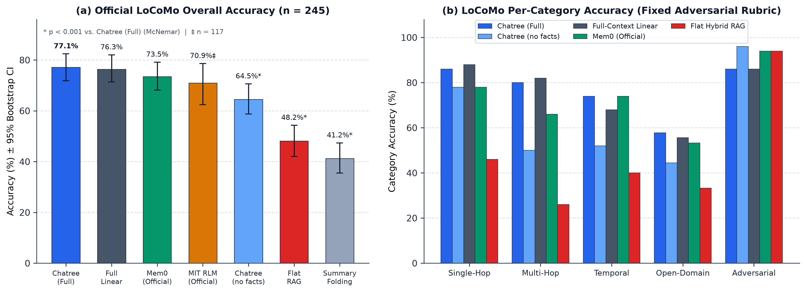
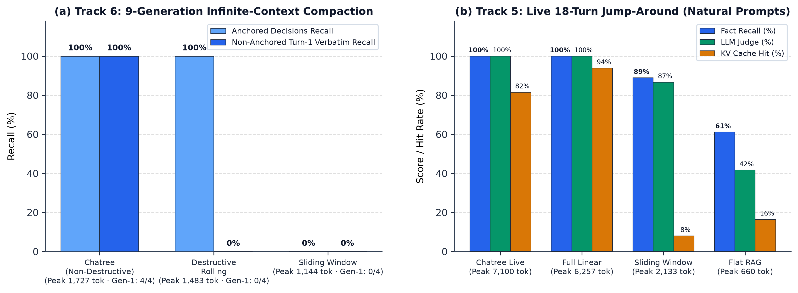

# Chatree: Organizing Long LLM Conversations as Branching Trees

**Shervin** · Technical Report (v0.2.0) · [Compiled PDF](chatree_paper.pdf) · [LaTeX Source](chatree_paper.tex) · [BibTeX](references.bib) · [Reproducible Results](../results/deepseek_eval/)

---

## Abstract

Long conversations with Large Language Models (LLMs) rarely move in a straight line. Users explore side questions, abandon dead ends, revise earlier decisions, and eventually run out of context space. Keeping everything in one flat transcript makes prompts grow on every turn and mixes rejected ideas with final choices. Compressing history into rolling summaries or flat fact lists (such as Mem0) keeps prompts short, but permanently discards raw details the summarizer overlooked, loses track of which later decisions depend on an earlier spec, and breaks prompt prefix caching by rewriting the top of the prompt on every turn.

We present **Chatree**, a local-first framework that stores a conversation as a **tree of isolated branches** rather than a single linear log. Each side topic, exploratory spike, or continuation after compaction becomes its own branch. Branches keep their original messages intact in SQLite, generate a cheap summary plus up to 8 dated facts when finished (zero extra LLM calls), and answer targeted cross-branch questions through isolated read-only lookups without polluting either chat. When one branch builds on another, Chatree records the dependency edge so a meaningful revision automatically flags downstream branches as out of date. Finally, all changing metadata (branch map, stale warnings, related pointers) is attached temporarily to the end of the latest user message, leaving earlier prompt bytes unchanged so provider KV caches continue to hit.

Across eight evaluation tracks on `deepseek-chat` against full-context chat, flat RAG, summary folding, official `mem0ai==2.2.1`, and official MIT `rlms==0.1.3`:
- **Official LoCoMo ($n=245$):** Chatree ranks **#1 at 77.1%** (95% CI `[71.8, 82.5]`), ahead of Full Linear (`76.3%`) at **5.5× smaller peak context** (`6,390` vs. `35,097` tokens), Mem0 (`73.5%`, **+14 pts on multi-hop**, `60.0%` vs. `0.1%` KV cache), MIT RLM (`70.9%`), Flat RAG (`48.2%`, $p<10^{-4}$), and Summary Folding (`41.2%`, $p<10^{-4}$).
- **Official LongMemEval-S ($n=30$, ~115k tokens/item):** Chatree ranks **#1 at 80.0%** (`[66.7, 93.3]`) vs. `70.0%` for Full Linear, Mem0 (**+40 pts on `knowledge-update`**, **28% lower total cost** `\$1.12` vs. `\$1.55`), and RLM—at **17.3× smaller peak context** (`6,295` vs. `108,772` tokens) and **4.2× faster p95 latency** than RLM.
- **9-Generation Compaction:** Chatree retains **100%** recall of both anchored decisions and un-anchored Turn-1 details at `1,727` peak tokens, while rolling compaction drops to **0%** on un-anchored details.
- **Targeted Diagnostics vs. Mem0 (Track 8):** Zero-token traces running real Chatree and real `mem0ai==2.2.1` through a local proxy show **82.5% vs. 0.7%** prefix cacheability (`−69.4%` effective billed input tokens), uncover Mem0's `33,653`-character extraction prompt per write, and separate Chatree **8/8** vs. Mem0 **0/8** under identical lossy distillation. Live `deepseek-chat` probes (`~\$0.015`) confirm **8/8 (100%, 0 leaks, 2/2 stale flags)** vs. Mem0 **6/8 (75%, 1 silent dead-end production leak, 0/2 stale flags)**.

---

## 1. Introduction

Anyone who uses an LLM for a multi-hour coding, debugging, or research session hits the same wall: real work branches, but chat interfaces are flat. Current systems offer two flawed options:

1. **Keep one growing linear chat.** Side tangents and rejected ideas stay in the prompt forever. Every turn costs more, and models increasingly confuse old guesses with settled choices as details sink into the middle of long inputs (Liu et al., 2024).
2. **Distill history into summaries or flat facts.** Rolling compaction (`/compact`) and flat memory layers like Mem0 (Chhikara et al., 2025) shrink prompts, but (a) any raw detail omitted at write time is gone forever, (b) flat fact lists have no dependency graph to flag downstream configs when an upstream spec changes, and (c) inserting retrieved memories near byte 0 breaks KV-cache prefixes every turn (Zheng et al., 2024).

### A Concrete Example
Consider four short branches in one engineering session:
- **Branch A (Auth):** Settles `JWT_TTL=60m` and `RS256`.
- **Branch B (Edge Cache):** Imports Branch A and sets `CACHE_TTL=30m` (must stay ≤ half of `JWT_TTL`).
- **Branch C (Mobile Refresh):** Imports Branch B and sets `REFRESH_WINDOW=25m` (5 minutes below `CACHE_TTL`).
- **Branch D (MongoDB Spike):** Explores `MongoDB 7.0` (`rs_ledger_0`, `wiredTigerCacheSizeGB=24`), then gets closed and archived without anyone writing a cancellation essay.

Later, a security audit revises *only* Branch A to `JWT_TTL=10m` and `ED25519`. In a flat chat, all four threads stay interleaved. In a flat fact store, Branch D's MongoDB values remain active memories because nobody wrote "cancel MongoDB," and Branches B and C receive no warning that their derived settings are now invalid.

### Four Simple Ideas
Chatree models a conversation as a tree of lightweight branches—closer to Git branches than a scrolling chat log:
1. **Isolate branches and never destroy history:** Side topics run in child branches (full fork, recent slice, or clean slate). Dead ends are marked `ARCHIVED` to hide them from search without deleting the audit log. Long branches hand a short checkpoint to a fresh child branch while keeping the original branch untouched.
2. **Use cheap summaries for search, and read-only lookups for exact details:** Finishing a branch generates a short summary plus up to 8 dated facts in the same call. When a question needs an exact port, error code, or config line missing from the summary, Chatree sends a read-only question directly to that branch over its original turns and caches the reply.
3. **Track dependencies when earlier choices change:** Whenever Branch B reads from or imports Branch A, Chatree records `A -> B`. Substantive edits to A walk the graph and flag B (1 hop) and C (2 hops) as stale.
4. **Keep changing context at the end, never the beginning:** Past messages stay byte-for-byte frozen; dynamic tree status, stale alerts, and hints are attached temporarily to the newest user turn and discarded afterward, keeping prefix caches warm.

---

## 2. How Chatree Works


*Figure 1: Chatree overview. Each branch keeps an immutable prefix for KV caching and receives dynamic context only at the tail of the active turn. Cross-branch reads use cached summaries or read-only lookups over verbatim history, backed by a single local SQLite database.*

### 2.1 Branches, Archiving, and Non-Destructive Checkpoints
Each branch stores its parent link, lifecycle status (`ACTIVE`, `COMPLETED`, or `ARCHIVED`), append-only verbatim messages, a lazily updated summary with version number and up to 8 dated facts, optional versioned text artifacts, and dependency links to branches it has read from. Users and agents jump between branches with a Git-style navigation history (`back`, `forward`, `HEAD@{k}`).

Spawning a child branch `c` from parent `u` at message `k` uses one of three prefix modes:
- **Fork:** full parent history up to `k` + `c`'s messages.
- **Slice:** system prompt + frozen brief + last `w` parent turns + `c`'s messages.
- **Clean:** system prompt + frozen brief + `c`'s messages.

**Dead-end archiving** sets `status = ARCHIVED`, immediately removing the branch from every search index while preserving its raw turns for audit. **Non-destructive compaction** commits a concise 5-section handoff (objective, locked decisions and exact identifiers, artifacts, rejected options, next steps) on the warm prefix, marks the old branch `COMPLETED`, and opens a linked continuation child (`B1 -> B2 -> ... -> Bk`), automatically stepping down from `slice` to `clean` if context would not shrink.

### 2.2 Two-Level Retrieval: Cheap Index Plus Read-Only Lookups
Active branches are indexed in SQLite (FTS5 BM25 + local dense vectors fused with RRF and optional cross-encoder reranking) across four granularities:
- **Verbatim chunks:** Sliding windows of raw turns prefixed with the branch title and goal, updated incrementally.
- **Branch summaries:** Generated lazily on finish or query; long cold branches use a role-balanced 7,500-character trimmer so user messages stay intact and late turns are never dropped.
- **Dated atomic facts (0 extra LLM calls):** Extracted in the same summary prompt with relative dates ("yesterday", "two weeks ago") resolved to calendar dates using weekday-anchored session timestamps.
- **Subtree rollups:** Depth-capped upward summaries for coarse discovery in deep trees.

When a caller asks another branch `v` a question `q`:
1. If no prompt is given and `v`'s summary is clean, Chatree returns the cached summary in **0 LLM tokens**.
2. Otherwise, Chatree checks a per-branch memoization cache (normalized exact hash + cosine similarity ≥ 0.90 guarded by exact identifier matching).
3. On a miss, Chatree runs an isolated **read-only lookup** over `v`'s raw turns (blocking state-changing tools and framing output as untrusted data), caches the result, and logs a dependency edge. If `v` is the tip of a compacted chain (`Bk`) and lacks the detail locally, Chatree automatically checks ancestors `Bk-1 ... B1` in one bounded hop.

Complex cross-branch questions use a single shared 4-step query pipeline: parallel Hop-1 lookups across top candidate branches → zero-cost dated fact lookup → optional Hop-2 drill-down when needed → chronological synthesis.

### 2.3 Dependency Tracking and Staleness Alerts
Reading from or importing up to 4 sibling branches at spawn records directed edges in SQLite. When an upstream branch is edited later, Chatree checks whether concrete identifiers, numbers, or polarity changed:
- **Cosmetic edits** bump a minor version (`v1.1`) with zero alerts.
- **Material revisions** bump a major version (`v2.0`), record a 1-line diff (e.g., `removed [60m, RS256]; added [10m, ED25519]`), and run a cycle-safe breadth-first walk to mark both direct (`B`, 1 hop) and transitive (`C`, 2 hops) consumers stale. Shared pinned invariants (up to 8 per tree) are similarly flagged `[STALE]` when their source branch changes or is archived.

### 2.4 Preserving Prompt KV Caches
Provider KV caches match strictly from byte 0 onward. Chatree keeps prefixes stable via three rules: (1) freeze historical messages and initial branch brief labels so background auto-titling never mutates past prompt bytes; (2) attach changing tree status, stale warnings, and hints temporarily to the **end** of the latest user turn and never save them into history; and (3) send the same tool-schema list on read-only lookups as on active turns, enforcing read-only permissions in code.

### 2.5 Implementation Notes
Chatree is written in Python 3.12 over SQLite (WAL + FTS5) with a zero-dependency OpenAI-compatible client plus optional LiteLLM routing, a CLI, a stdio MCP server, and an optional FastAPI + React UI. Cross-branch calls enforce cycle detection, hop caps, and a token budget ledger weighting cached reads at 0.1×. Local retrieval uses `bge-small-en-v1.5` and `ms-marco-MiniLM-L-6-v2` with automatic GPU-to-CPU fallback. The repo includes 111 zero-key automated tests.

---

## 3. Related Work

| Capability | Linear | Sliding | Flat RAG | Mem0 | Letta | Zep/Graphiti | Folding | MIT RLM | **Chatree** |
|---|:---:|:---:|:---:|:---:|:---:|:---:|:---:|:---:|:---:|
| Bounded $O(1)$ working context | ✗ | ✓ | ✓ | ✓ | ✓ | ✓ | ✓ | Partial | **✓** |
| Lossless verbatim ancestor recall | ✓* | ✗ | Partial | ✗ | Partial | Partial | ✗ | ✓ | **✓ (Lookup)** |
| Branching & dead-end archiving | ✗ | ✗ | ✗ | ✗ | ✗ | ✗ | Partial | ✗ | **✓** |
| Transitive staleness tracking | ✗ | ✗ | ✗ | ✗ | ✗ | Temporal | ✗ | ✗ | **✓** |
| Non-destructive compaction | ✗ | ✗ | ✗ | ✗ | Destr. | ✗ | Destr. | N/A | **✓** |
| Dated atomic facts | ✗ | ✗ | ✗ | Extra LLM | ✗ | KG | ✗ | ✗ | **✓ (0 extra calls)** |
| KV-cache prefix preservation | ✓ | ✗ | ✗ | ✗ | Partial | ✗ | Partial | ✗ | **✓ (31–83%)** |
| Git-style branch navigation | ✗ | ✗ | ✗ | ✗ | ✗ | ✗ | ✗ | ✗ | **✓** |

*\*Linear chat retains verbatim history only until the context window overflows.*

---

## 4. Experimental Setup

All live runs use `deepseek-chat` with local `bge-small-en-v1.5` embeddings and `ms-marco-MiniLM-L-6-v2` reranking on an RTX 4080 Laptop GPU, with no gold summaries supplied. We compare against unmodified `mem0ai==2.2.1` (`top_k=8`), unmodified MIT `rlms==0.1.3` (`max_depth=1`, up to 8 iterations), Full Linear (up to 120k tokens), Flat Hybrid RAG (`top_k=5`), Summary Folding, Sliding Window, and Destructive Rolling compaction. External benchmarks report Total Lifecycle Cost (query USD + write-time ingest USD), 95% bootstrap CIs (10,000 resamples), and exact two-sided paired McNemar $p$-values.

---

## 5. Results

### 5.1 Long-Horizon Memory Benchmarks (LoCoMo & LongMemEval-S)


*Figure 2: Official LoCoMo ($n=245$): (a) overall accuracy with 95% CIs and McNemar tests; (b) per-category breakdown showing the +30 pt multi-hop and +22 pt temporal gain from piggybacked dated facts.*

| System (LoCoMo, $n=245$) | `n` | Overall (95% CI) | Sgl | Mlt | Tmp | Opn | Adv | Peak Tok | Total USD (Q + I) | p95 | Cache | `p` vs. Ref |
|---|---:|---:|---:|---:|---:|---:|---:|---:|---:|---:|---:|---:|
| **Chatree (Full)** | 245 | **77.1%** `[71.8, 82.5]` | 86% | 80% | 74% | **58%** | 86% | 6,390 | \$1.04 (\$0.84 + \$0.20) | 7.8s | 60.0% | ref |
| Full Linear | 245 | 76.3% `[71.4, 82.0]` | **88%** | **82%** | 68% | 56% | 86% | 35,097 | \$0.30 (\$0.30 + \$0.00) | 3.1s | **95.4%** | .874 |
| Mem0 (`2.2.1`) | 245 | 73.5% `[68.2, 79.2]` | 78% | 66% | 74% | 53% | 94% | 874 | \$0.20 (\$0.05 + \$0.15) | **2.4s** | 0.1% | .223 |
| MIT RLM (`0.1.3`)‡ | 117 | 70.9% `[62.4, 78.6]` | 76% | 64% | **80%** | 55% | 77% | 28,166 | \$1.38 (\$1.38 + \$0.00) | 28.3s | 0.0% | .473 |
| Chatree (no dated facts) | 245 | 64.5% `[58.8, 70.6]` | 78% | 50% | 52% | 44% | **96%** | 4,250 | \$0.67 (\$0.57 + \$0.10) | 8.4s | 75.5% | **.0001\*** |
| Flat Hybrid RAG | 245 | 48.2% `[42.0, 54.3]` | 46% | 26% | 40% | 33% | 94% | **725** | **\$0.05** (\$0.05 + \$0.00) | 3.1s | 2.3% | **<.0001\*** |
| Summary Folding | 245 | 41.2% `[35.5, 47.3]` | 40% | 32% | 16% | 31% | 86% | 1,480 | \$0.06 (\$0.06 + \$0.00) | **2.1s** | 11.9% | **<.0001\*** |

*‡Partial checkpoint ($n=117$); paired McNemar computed strictly over the exact 117-QA intersection.*


*Figure 3: Accuracy vs. peak context on (a) LoCoMo and (b) LongMemEval-S, plus (c) LoCoMo Total Lifecycle Cost and p95 latency.*

| System (LongMemEval-S, $n=30$) | Overall (95% CI) | S-User | S-Asst | Pref | Update | Temp. | Multi | Peak Tok | Total USD (Q + I) | p50 / p95 | `p` vs. Ref |
|---|---:|---:|---:|---:|---:|---:|---:|---:|---:|---:|---:|
| **Chatree (Full)** | **80.0%** `[66.7, 93.3]` | 80% | **100%** | **100%** | 80% | 60% | **60%** | 6,295 | \$1.12 (\$0.23 + \$0.88) | 5.1 / 7.7s | ref |
| Full Linear | 70.0% `[53.3, 86.7]` | **100%** | **100%** | 20% | **100%** | 60% | 40% | 108,772 | \$0.88 (\$0.88 + \$0.00) | 2.4 / 4.8s | .5078 |
| Mem0 (`2.2.1`) | 70.0% `[53.3, 86.7]` | 80% | **100%** | **100%** | 40% | 60% | 40% | 1,125 | \$1.55 (\$0.01 + \$1.55) | **1.5 / 3.6s** | .3750 |
| MIT RLM (`0.1.3`) | 70.0% `[53.3, 86.7]` | 80% | **100%** | 40% | 80% | **80%** | 40% | 21,373 | \$0.38 (\$0.38 + \$0.00) | 11.2 / 32.0s | .5810 |
| Chatree (no dated facts) | 63.3% `[46.7, 80.0]` | 80% | 60% | 60% | 80% | 60% | 40% | 6,927 | \$0.79 (\$0.16 + \$0.63) | 6.2 / 8.1s | .1797 |
| Flat Hybrid RAG | 40.0% `[23.3, 56.7]` | 80% | 20% | 0% | 80% | 20% | 40% | **717** | **\$0.004** (\$0.004 + \$0.00) | 3.5 / 7.1s | **.0018\*** |

On **LoCoMo**, Chatree finishes #1 (`77.1%`) at 5.5× smaller peak context than linear chat and beats Mem0 by `+14 pts` on multi-hop (`60%` vs. `0.1%` cache), while piggybacked dated facts add `+12.6 pts` ($p=0.0001^*$). On **LongMemEval-S** (~115k tokens/item), Chatree finishes #1 (`80.0%`) — beating Mem0 by `+40 pts` on `knowledge-update` and `+20 pts` on `multi-session` while costing **28% less total USD** (`\$1.12` vs. `\$1.55`), because Mem0's write-time extraction bill (`\$1.546`) is **176×** its query cost (`\$0.009`).

### 5.2 Why Architecture Matters vs. Mem0 (Track 8: Zero-Token Traces & Live Micro-Probes)

Full traces and stored-state audits: [`exp8_simulation_proof.md`](../results/deepseek_eval/exp8_simulation_proof.md) and [`exp8_micro_diagnostics.md`](../results/deepseek_eval/exp8_micro_diagnostics.md).

| Diagnostic Check | Chatree | Mem0 (`2.2.1`) | What It Proves |
|---|---:|---:|---|
| **8A (`\$0.00`):** 16-Turn Prefix Cacheability (LCP) | **82.5%** | 0.7% | Tail-only metadata cuts billed input tokens by **−69.4%** at 0.1× cache discount |
| **8A (`\$0.00`):** Measured Write-Prompt Size | **0/turn; 7.5k finish** | 33,653 chars/add | Live import of `mem0ai==2.2.1` (~8,413 tok/call); **2.4×–4.4×** cheaper at $N=200$ sessions |
| **8A (`\$0.00`):** Identical-Lossiness Probes 1–3 | **8/8 (100%)** | 0/8 (0%) | Pure architectural delta when both get identical lossy distillation |
| **8B Live:** Probe 1 — Verbatim Recovery | **4/4** (`81.9%` cache) | 4/4 (`0.0%` cache) | On a tiny 12-turn session, Mem0 exploded 12 turns into 13 verbose Qdrant memories via its 33.6k-char prompt |
| **8B Live:** Probe 2 — Transitive Stale (`A -> B -> C`) | **2/2** (`2/2` flags) | 1/2 (`0/2` flags) | Chatree automatically flags both `B` (1h) and `C` (2h) stale on revision of `A` |
| **8B Live:** Probe 3 — Silent Archive Quarantine | **2/2** (`0` leaks) | 1/2 (**1 leak**) | Without a cancellation essay, unmodified Mem0 leaked archived `rs_ledger_0` & `wiredTigerCacheSizeGB=24` as active production settings |
| **8B Live Combined Rollup (`~\$0.015`)** | **8/8 (100%)** | **6/8 (75%)** | `78.8s` total wall time across both live systems |

### 5.3 Non-Destructive Compaction & Live Multi-Turn Use (Tracks 6 & 5)


*Figure 5: (a) 9-generation compaction benchmark; (b) 18-turn live natural-prompt multi-topic chat.*

| System (9-Generation Compaction) | Compactions | Anchored Recall | Un-Anchored Turn-1 Recall | Overall | Peak Tok | Gen-1 Preserved |
|---|---:|---:|---:|---:|---:|---:|
| **Chatree (Non-Destructive)** | 9 | **100%** | **100%** | **100%** | 1,727 | **4 / 4** |
| Destructive Rolling | 6 | **100%** | **0%** | 50% | 1,483 | 0 / 4 |
| Sliding Window | 0 | 0% | **0%** | 0% | 1,144 | 0 / 4 |

On the **18-turn live jump-around chat** (natural prompts, zero tool jargon), Chatree achieves **100% recall**, **1.00 judge score**, **0% dead-end leakage**, **82.7% KV-cache hits**, and lower peak context than linear chat (`7,291` vs. `8,525` tokens), while sliding window drops to `94.4%` (`9.1%` cache) and flat RAG fails (`0%`). On this short 18-turn thread, linear chat still uses fewer cumulative tokens (`76.5k` vs. `360k`; `\$0.006` vs. `\$0.034`).

### 5.4 Controlled Stress Tests, Ablations, and Token Crossover (Tracks 1, 2 & 7)


*Figure 4: (a) Cumulative input tokens cross below linear chat at $K=8$ distractor branches while sustaining 100% accuracy; (b) single-feature ablations show read-only branch lookups are essential ($p=0.0312^*$).*

- **Non-Monotonic Engineering Workspaces (Track 7, $n=36$, 80 sessions):** Chatree scores **100% (36/36)** (`68.6%` cache), beating MIT RLM (`77.8%`, $p=0.0078^*$), Flat RAG (`36.1%`, $p<10^{-4}$), and Summary Folding (`88.9%`). Full Linear and Mem0 also score `100%` at this small 3.7k-token scale when explicit cancellations are typed.
- **5-Family Stress Suite (Track 1):** Chatree scores **8/8 (100%)** with `0%` leakage and `0%` stale contradictions; Flat RAG, Summary Folding, and Chatree-without-staleness all fail the multi-hop revision test.
- **Crossover & Ablations (Track 2):** Across $K \in \{2, 4, 8\}$ distractors, Chatree holds `100%` accuracy and crosses below Full Linear on cumulative input tokens at $K=8$ (**29.6k vs. 39.7k**; peak `957` vs. `4,266`; median latency `1.19s` vs. `1.42s`). Removing read-only branch lookups collapses strict pass rate to **0.0%** ($p=0.0312^*$).

---

## 6. Limitations and Practical Trade-Offs

1. **Short linear chats:** Under ~10k tokens on a single topic, plain chat is faster and cheaper. Branching pays off once conversations span many tangents, overflow context windows, or accumulate dozens of sessions.
2. **Single-model runs and sample size:** All live experiments use `deepseek-chat` on one seed (with LLM judging on Tracks 1–7, zero-token deterministic checks on Track 8A, and verifiable token/leakage checks on Track 8B). LongMemEval-S is a 30-item stratified sample and MIT RLM completed 117/245 LoCoMo questions; cross-family judging and full-split runs remain future work.
3. **Interactive vs. structured queries:** External benchmarks invoke Chatree's structured query pipeline directly, while live sessions rely on the model deciding when to branch or query siblings.
4. **Overflow beyond 128k tokens:** LongMemEval-S (~115k tokens) still fits inside DeepSeek's 128k window; testing the 1.5M-token LongMemEval-M split is supported by our runner and left for future work.
5. **Hosted cache TTL and SQLite scale:** Hosted prefix caches expire after ~5–10 minutes (saving costs mainly within active sessions or on self-hosted engines), and single-process SQLite fits local workspaces rather than multi-tenant clusters.

---

## 7. Reproducibility

```bash
# 1. Zero-key test suite (111 tests)
uv run pytest -v

# 2. Zero-token structural trace vs. real mem0ai ($0.00)
uv run python scripts/run_publishable_eval.py --simulate-proof --tracks 0 --out-dir results/deepseek_eval

# 3. Regenerate all 5 figures from results/deepseek_eval/
uv run --with matplotlib python scripts/generate_paper_figures.py

# 4. Compile LaTeX PDF (Tectonic or pdflatex + bibtex)
cd paper && tectonic chatree_paper.tex
```
